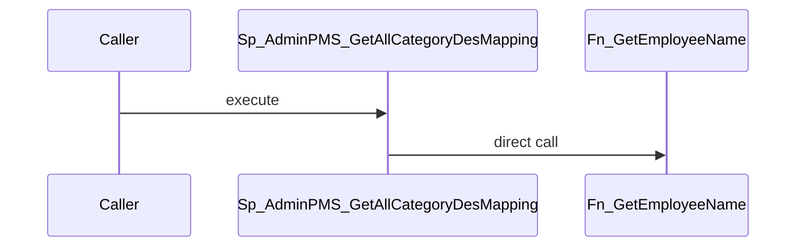
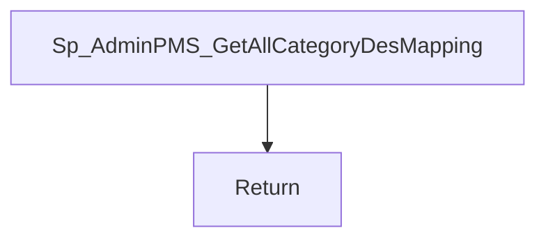

# Sp_AdminPMS_GetAllCategoryDesMapping

## What it does

Stored procedure `Sp_AdminPMS_GetAllCategoryDesMapping`. Reads `TPMSCompetencyMaster`, `TPMSDesignationMappingForDesignation`, `TTitle`, `TPMSDesignationMappingForRole`, `TEmployeeRoleMaster`, `TPMSDesignationMappingForBU`, `TOrgHierarchyDetails`, `TPMSAppraisalCycles`, and others. Calls `Fn_GetEmployeeName`.

## Parameters

| Name | Direction | What it is for |
|---|---|---|
| `@EmployerId` | in | INT |

## Call sequence

## Callers

No other procedure or function calls this object.

## Nested

| Object | Kind | When | Page |
|---|---|---|---|
| `Fn_GetEmployeeName` | function | direct call | [Fn_GetEmployeeName](/docs/database/hrms/Fn_GetEmployeeName) |

## Steps

1. Script is `HRMS-DATABASE/HRMS/STOREPROCEDURE/Sp_AdminPMS_GetAllCategoryDesMapping.sql`.

## Tables

| Table | Read or write |
|---|---|
| `TEmployeeRoleMaster` | read |
| `TOrgHierarchyDetails` | read |
| `TPMSAppraisalCycles` | read |
| `TPMSCategoryDesignationMapping` | read |
| `TPMSCategoryMaster` | read |
| `TPMSCompetencyMaster` | read |
| `TPMSDesignationMappingForBU` | read |
| `TPMSDesignationMappingForDesignation` | read |
| `TPMSDesignationMappingForRole` | read |
| `TPMSEmployeeGoalSetting` | read |
| `TTitle` | read |
| `TemployerDetails` | read |
| `temployeeinfo` | read |

## Flow

