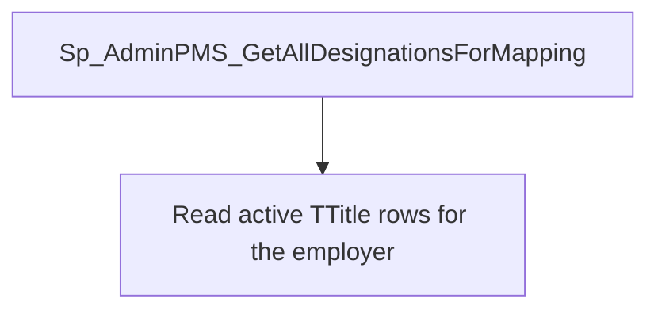

# Sp_AdminPMS_GetAllDesignationsForMapping

## What it does

Returns the id and title of active titles for one employer. Policy Documents Setup binds that list to the designation exclusion control. The script has no description beyond the parameter.

`PerformanceManagementDAL.GetAllDesignationforMapping` calls this. The page reaches it through `PerformanceManagementBLL.GetAllDesignationforMapping`.

## Parameters

| Name | Direction | What it is for |
|---|---|---|
| `@EmployerId` | in | Employer whose active titles are listed. |

## Call sequence

Calls no other procedures or functions.

## Callers

No other procedure or function calls this object. `PerformanceManagementDAL.GetAllDesignationforMapping` executes it. Policy Documents Setup uses that list for the designation exclusion.

## Nested

Calls no other procedures or functions.

## Steps

1. In `HRMS-DATABASE/HRMS/STOREPROCEDURE/Sp_AdminPMS_GetAllDesignationsForMapping.sql`, select `ID` and `Title` from `TTitle`.
2. Keep a title only when its `ID` is also returned by the inner select of `TTitle` where `IsActive` is `Y` and `Employerid` is `@EmployerId`.
3. The outer select does not itself filter `IsActive` or `Employerid`. The inner select supplies both filters.

`TTitle` declares a primary key on `ID` and no foreign key. Policy Documents Setup stores the selected ids in `DesignationIDs`. The insert and update procedures compare those ids with `TEmployeeInfo.DesignationId`, which has no foreign key to `TTitle`.

## Tables

| Table | Read or write |
|---|---|
| `dbo.TTitle` | read |

## Flow

