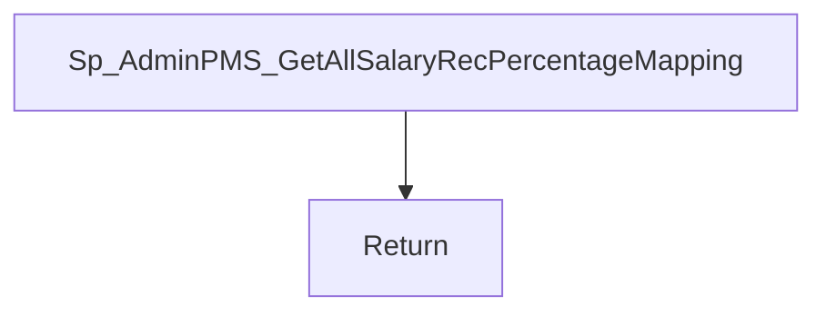

# Sp_AdminPMS_GetAllSalaryRecPercentageMapping

## What it does

Stored procedure `Sp_AdminPMS_GetAllSalaryRecPercentageMapping`. Reads `TPMSRatingMaster`, `TpmsWeightagemaster`, `TPMSRatingscaleDetails`, `TPMSWeightageScaleDetails`, `TPMSSalaryRecPercentageForDesignation`, `TTitle`, `TPMSSalaryRecPercentageForRole`, `TEmployeeRoleMaster`, and others. Calls no other procedure or function.

## Parameters

| Name | Direction | What it is for |
|---|---|---|
| `@EmployerId` | in | INT |

## Call sequence

Calls no other procedures or functions.

## Callers

No other procedure or function calls this object.

## Nested

Calls no other procedures or functions.

## Steps

1. Script is `HRMS-DATABASE/HRMS/STOREPROCEDURE/Sp_AdminPMS_GetAllSalaryRecPercentageMapping.sql`.

## Tables

| Table | Read or write |
|---|---|
| `TEmployeeRoleMaster` | read |
| `TOrgHierarchyDetails` | read |
| `TPMSAppraisalCycles` | read |
| `TPMSRatingMaster` | read |
| `TPMSRatingscaleDetails` | read |
| `TPMSSalaryRecPercentageForBU` | read |
| `TPMSSalaryRecPercentageForDesignation` | read |
| `TPMSSalaryRecPercentageForMapping` | read |
| `TPMSSalaryRecPercentageForRole` | read |
| `TPMSSalaryRevForEmployeeAssessment` | read |
| `TPMSWeightageScaleDetails` | read |
| `TTitle` | read |
| `TpmsWeightagemaster` | read |

## Flow

