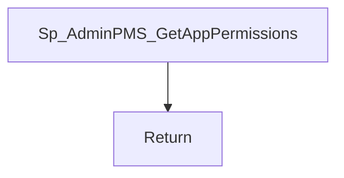

# Sp_AdminPMS_GetAppPermissions

## What it does

Stored procedure `Sp_AdminPMS_GetAppPermissions`. Reads `TOrgHierarchyDetails`, `TPMSAppraisalViewManagerPermissions`, `TPMS_ViewEmpManagerRatingPermissions`, `TPMS_ViewManagerCommentsPermissions`, `TPMS_ViewManagerRatingPermissions`, `TPMSAppraisalPermissions`, `TPMSAppraisalCycles`. Calls no other procedure or function.

## Parameters

| Name | Direction | What it is for |
|---|---|---|
| `@Employerid` | in | Int |

## Call sequence

Calls no other procedures or functions.

## Callers

No other procedure or function calls this object.

## Nested

Calls no other procedures or functions.

## Steps

1. Script is `HRMS-DATABASE/HRMS/STOREPROCEDURE/Sp_AdminPMS_GetAppPermissions.sql`.

## Tables

| Table | Read or write |
|---|---|
| `TOrgHierarchyDetails` | read |
| `TPMSAppraisalCycles` | read |
| `TPMSAppraisalPermissions` | read |
| `TPMSAppraisalViewManagerPermissions` | read |
| `TPMS_ViewEmpManagerRatingPermissions` | read |
| `TPMS_ViewManagerCommentsPermissions` | read |
| `TPMS_ViewManagerRatingPermissions` | read |

## Flow

