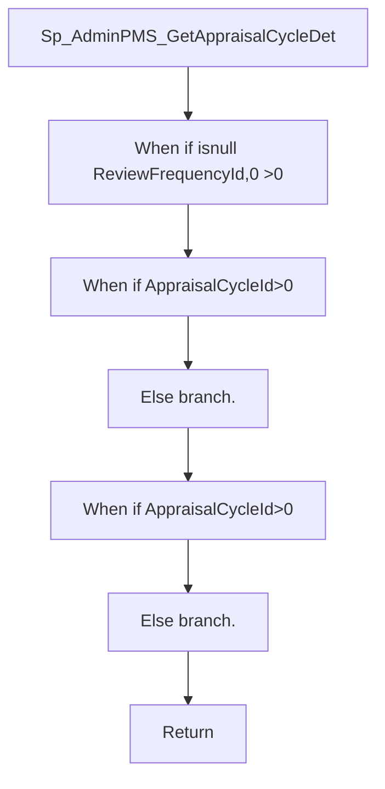

# Sp_AdminPMS_GetAppraisalCycleDet

## What it does

Stored procedure `Sp_AdminPMS_GetAppraisalCycleDet`. Reads `TPMSRatingMaster`, `TPMSGOALCATEGORY`, `TPMSGOALCATEGORYDETAILS`, `TPMSWeightageMaster`, `TPMSCategoryDesignationMapping`, `TPMSEmployeeAppraisalCycleMapping`, `tpmsappraisalcycles`, `TPMS_AppraisalReviewFrequency`, and others. Calls no other procedure or function.

## Parameters

| Name | Direction | What it is for |
|---|---|---|
| `@AppraisalCycleId` | in | Int, default 0 |
| `@Employerid` | in | Int |
| `@GoalSettingId` | in | int, default 0 |
| `@ReviewFrequencyId` | in | int, default 0 |

## Call sequence

Calls no other procedures or functions.

## Callers

No other procedure or function calls this object.

## Nested

Calls no other procedures or functions.

## Steps

1. Script is `HRMS-DATABASE/HRMS/STOREPROCEDURE/Sp_AdminPMS_GetAppraisalCycleDet.sql`.
2. When if(isnull(@ReviewFrequencyId,0)>0)
3. When if(@AppraisalCycleId>0)
4. Else branch.
5. When if(@AppraisalCycleId>0)
6. Else branch.

## Tables

| Table | Read or write |
|---|---|
| `TPMSCategoryDesignationMapping` | read |
| `TPMSCategoryMaster` | read |
| `TPMSEmployeeAppraisalCycleMapping` | read |
| `TPMSEmployeeGoalSetting` | read |
| `TPMSEmployeeGoalSettingTemplate` | read |
| `TPMSGOALCATEGORY` | read |
| `TPMSGOALCATEGORYDETAILS` | read |
| `TPMSRatingMaster` | read |
| `TPMSWeightageMaster` | read |
| `TPMS_AppraisalReviewFrequency` | read |
| `TPMS_AssesmentGoalReviewFrequencies` | read |
| `TPMS_GoalSettingReviewFrequency` | read |
| `temployee` | read |
| `tpmsappraisalcycles` | read |
| `tpmsemployeegoalmapping` | read |

## Flow

