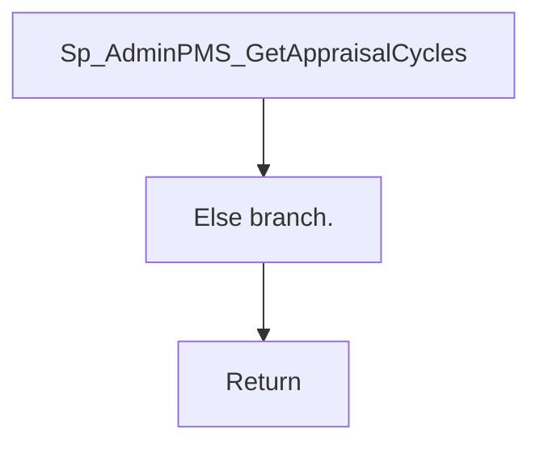

# Sp_AdminPMS_GetAppraisalCycles

## What it does

Stored procedure `Sp_AdminPMS_GetAppraisalCycles`. Reads `TPMSRatingMaster`, `TPMSWeightageMaster`, `TPMS_AppraisalReviewSequence`, `TPMSAppraisalCyclesForBU`, `TPMSAppraisalCyclesForRole`, `TPMSAppraisalCyclesForDesignation`, `TPMS_AssesmentGoalReviewFrequencies`, `TPMS_AppraisalNineBoxGrid`, and others. Calls no other procedure or function.

## Parameters

| Name | Direction | What it is for |
|---|---|---|
| `@Employerid` | in | Int |

## Call sequence

Calls no other procedures or functions.

## Callers

No other procedure or function calls this object.

## Nested

Calls no other procedures or functions.

## Steps

1. Script is `HRMS-DATABASE/HRMS/STOREPROCEDURE/Sp_AdminPMS_GetAppraisalCycles.sql`.
2. Else branch.

## Tables

| Table | Read or write |
|---|---|
| `TPMSAppraisalCycles` | read |
| `TPMSAppraisalCyclesForBU` | read |
| `TPMSAppraisalCyclesForDesignation` | read |
| `TPMSAppraisalCyclesForRole` | read |
| `TPMSEmployeeAppraisalCycleMapping` | read |
| `TPMSRatingMaster` | read |
| `TPMSWeightageMaster` | read |
| `TPMS_AppraisalNineBoxGrid` | read |
| `TPMS_AppraisalReviewFrequency` | read |
| `TPMS_AppraisalReviewSequence` | read |
| `TPMS_AssesmentGoalReviewFrequencies` | read |
| `tpmsemployeegoalmapping` | read |

## Flow

