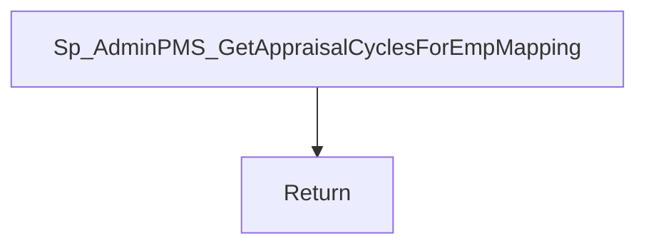

# Sp_AdminPMS_GetAppraisalCyclesForEmpMapping

## What it does

Stored procedure `Sp_AdminPMS_GetAppraisalCyclesForEmpMapping`. Reads `TPMSAppraisalCycles`, `TPMS_AppraisalReviewFrequency`. Calls no other procedure or function.

## Parameters

| Name | Direction | What it is for |
|---|---|---|
| `@Employerid` | in | Int |
| `@AppraisalCycleId` | in | int, default null |

## Call sequence

Calls no other procedures or functions.

## Callers

No other procedure or function calls this object.

## Nested

Calls no other procedures or functions.

## Steps

1. Script is `HRMS-DATABASE/HRMS/STOREPROCEDURE/Sp_AdminPMS_GetAppraisalCyclesForEmpMapping.sql`.

## Tables

| Table | Read or write |
|---|---|
| `TPMSAppraisalCycles` | read |
| `TPMS_AppraisalReviewFrequency` | read |

## Flow

