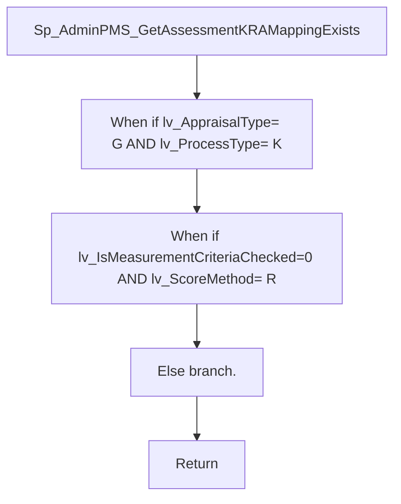

# Sp_AdminPMS_GetAssessmentKRAMappingExists

## What it does

Stored procedure `Sp_AdminPMS_GetAssessmentKRAMappingExists`. Reads `TPMSCategorymaster`, `TPMSRatingScaleDetails`, `tpmsappraisalcycles`. Calls no other procedure or function.

## Parameters

| Name | Direction | What it is for |
|---|---|---|
| `@CategoryId` | in | Int |
| `@EmployerId` | in | Int |
| `@AppraisalCycleId` | in | Int |

## Call sequence

Calls no other procedures or functions.

## Callers

No other procedure or function calls this object.

## Nested

Calls no other procedures or functions.

## Steps

1. Script is `HRMS-DATABASE/HRMS/STOREPROCEDURE/Sp_AdminPMS_GetAssessmentKRAMappingExists.sql`.
2. When if(@lv_AppraisalType='G' AND @lv_ProcessType='K')
3. When if(@lv_IsMeasurementCriteriaChecked=0 AND @lv_ScoreMethod='R')
4. Else branch.

## Tables

| Table | Read or write |
|---|---|
| `TPMSCategorymaster` | read |
| `TPMSRatingScaleDetails` | read |
| `tpmsappraisalcycles` | read |

## Flow

