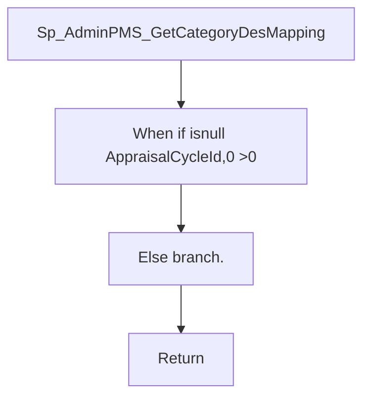

# Sp_AdminPMS_GetCategoryDesMapping

## What it does

Stored procedure `Sp_AdminPMS_GetCategoryDesMapping`. Reads `TTitle`, `TPMSCategoryDesignationMapping`, `TPMSDesignationMappingForDesignation`. Calls no other procedure or function.

## Parameters

| Name | Direction | What it is for |
|---|---|---|
| `@CategoryId` | in | Int |
| `@EmployerId` | in | Int |
| `@AppraisalCycleId` | in | INT |
| `@GoalSettingId` | in | INT |

## Call sequence

Calls no other procedures or functions.

## Callers

No other procedure or function calls this object.

## Nested

Calls no other procedures or functions.

## Steps

1. Script is `HRMS-DATABASE/HRMS/STOREPROCEDURE/Sp_AdminPMS_GetCategoryDesMapping.sql`.
2. When if(isnull(@AppraisalCycleId,0)>0)
3. Else branch.

## Tables

| Table | Read or write |
|---|---|
| `TPMSCategoryDesignationMapping` | read |
| `TPMSDesignationMappingForDesignation` | read |
| `TTitle` | read |

## Flow

