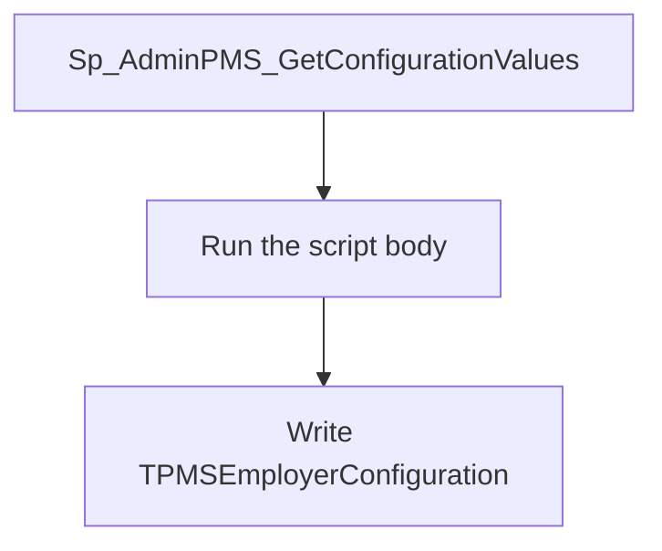

# Sp_AdminPMS_GetConfigurationValues

## What it does

Returns performance and confirmation configuration for an employer. When no configuration row exists, it inserts a default row first.

## Parameters

| Name | Direction | What it is for |
|---|---|---|
| `@EmployerId` | in | Employer Id |

## Call sequence

Calls no other procedures or functions.

## Callers

No other procedure or function calls this object.

## Nested

Calls no other procedures or functions.

## Steps

Script: `HRMS-DATABASE/HRMS/STOREPROCEDURE/Sp_AdminPMS_GetConfigurationValues.sql`.

1. IF(select count(1) from TPMSEmployerConfiguration where employerid =@EmployerId) =0
2. INSERT INTO TPMSEmployerConfiguration(EmployerId ,
3. Select EmployerId ,
4. SELECT 1 IsPMSForMultipleApprisalCyle,
5. SELECT ',' + Convert(varchar(10),s.ReviewLevelId )
6. SELECT ',' + Convert(varchar(10),s.NonConfirmedEmploymentType ) + '-' + Convert(varchar(10),s.ConfirmedEmploymentType)
7. SELECT ',' + Convert(varchar(10),s.ReviewLevelId )
8. SELECT ',' + Convert(varchar(10),s.ReviewLevel )
9. SELECT ',' + Convert(varchar(10),s.ReviewLevelId )
10. SELECT ',' + Convert(varchar(10),s.RowNo )
11. SELECT ',' + Convert(varchar(1000),s.ReviewLevelId )
12. SELECT ',' + Convert(varchar(1000),s.RowNo )

## Tables

| Table | Read or write |
|---|---|
| `TPMSEmployerConfiguration` | read/write |
| `TEmployerDetails` | read |
| `TCMSConfirmationViewManagerPermissions` | read |
| `TPMSAssessmentViewManagerPermissions` | read |
| `TCMSMappingEmploymentTypes` | read |
| `TCMS_AssessmentCommentPermissions` | read |
| `TCMS_AssessmentRatingPermissions` | read |
| `TPMS_GoalDefinationPermissions` | read |
| `TPMS_GoalAdditionalCompPermissions` | read |

## Flow

