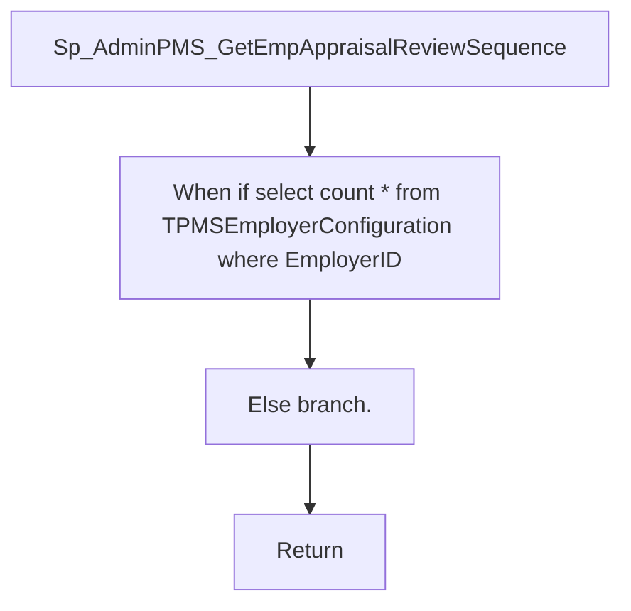

# Sp_AdminPMS_GetEmpAppraisalReviewSequence

## What it does

Stored procedure `Sp_AdminPMS_GetEmpAppraisalReviewSequence`. Reads `TPMSEmployerConfiguration`, `TPMSAppraisalCycles`, `TPMS_AppraisalReviewSequence`. Calls no other procedure or function.

## Parameters

| Name | Direction | What it is for |
|---|---|---|
| `@Employerid` | in | Int |
| `@AppraisalCycleId` | in | int |

## Call sequence

Calls no other procedures or functions.

## Callers

No other procedure or function calls this object.

## Nested

Calls no other procedures or functions.

## Steps

1. Script is `HRMS-DATABASE/HRMS/STOREPROCEDURE/Sp_AdminPMS_GetEmpAppraisalReviewSequence.sql`.
2. When if((select count(*) from TPMSEmployerConfiguration where EmployerID = @Employerid and IsSelfassessmentIsRequired =1)>0)
3. Else branch.

## Tables

| Table | Read or write |
|---|---|
| `TPMSAppraisalCycles` | read |
| `TPMSEmployerConfiguration` | read |
| `TPMS_AppraisalReviewSequence` | read |

## Flow

