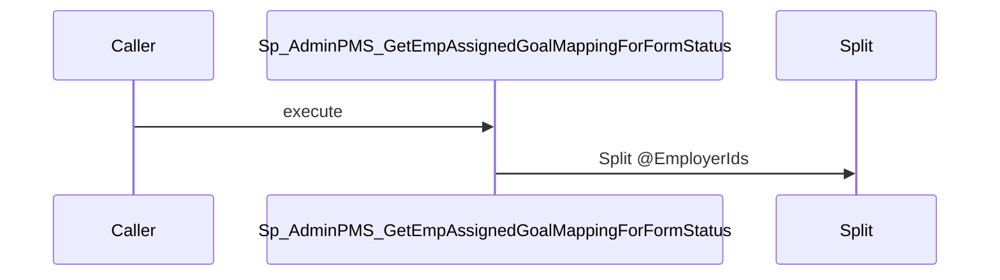
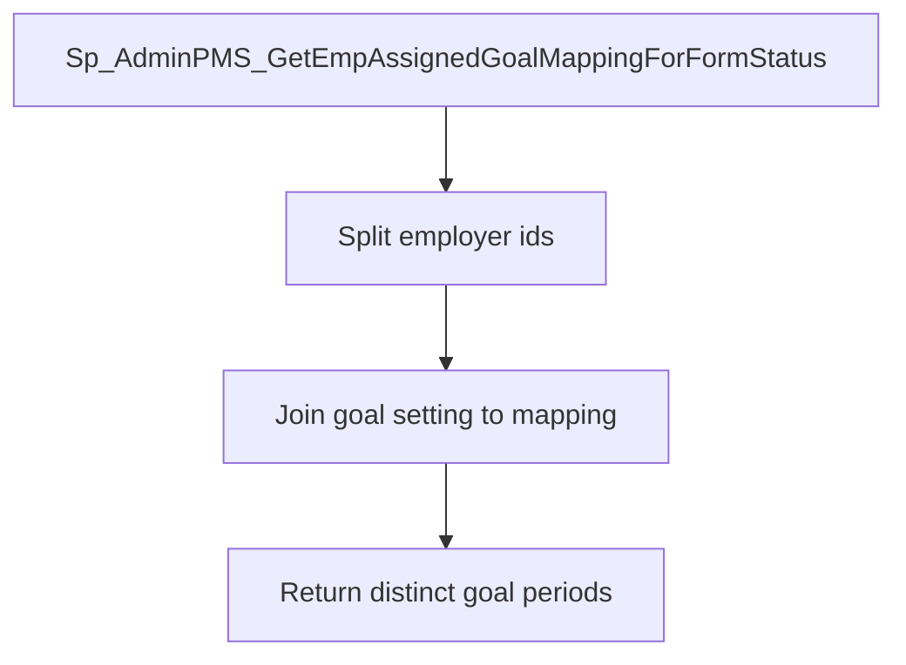

# Sp_AdminPMS_GetEmpAssignedGoalMappingForFormStatus

## What it does

Returns distinct goal periods that already have at least one employee mapping for the given employer id list. Used by Assessment Status to fill the Goal Period multiselect.

## Parameters

| Name | Direction | What it is for |
|---|---|---|
| `@EmployerIds` | in | Comma-separated employer ids (default `'0'`) |

## Call sequence

## Callers

No other procedure or function calls this object.

## Nested

| Object | Kind | When | Page |
|---|---|---|---|
| `Split` | function | split `@EmployerIds` | [Split](/docs/database/hrms/Split) |

## Steps

Script: `HRMS-DATABASE/HRMS/STOREPROCEDURE/Sp_AdminPMS_GetEmpAssignedGoalMappingForFormStatus.sql`.

1. Insert employer ids from `DBO.Split(@EmployerIds,',')` into a table variable.
2. `SELECT DISTINCT` `GoalSettingId`, `GoalPeriodName`, `IsActive`, `IsGoalFreezed`, `IsDeleted`, `GoalType` from `TPMSEmployeeGoalSetting` joined to `TPMSEmployeeGoalMapping`.
3. Filter `Employerid` in the employer list and `IsDeleted = 0`, order by `GoalSettingId` descending.

## Tables

| Table | Read or write |
|---|---|
| `TPMSEmployeeGoalSetting` | read |
| `TPMSEmployeeGoalMapping` | read |

## Flow

