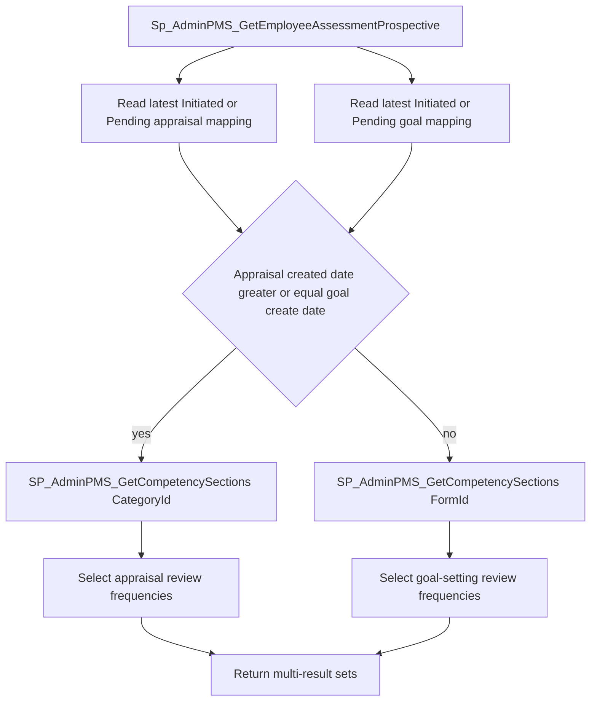

# Sp_AdminPMS_GetEmployeeAssessmentProspective

## What it does

For one employee, finds the latest appraisal-cycle mapping with cycle status Initiated or Pending and the latest goal-period mapping with goal status Initiated or Pending. Compares the appraisal cycle created date to the goal period create date. When the appraisal is newer or equal, it loads that cycle’s competency/KRA/goal form via `SP_AdminPMS_GetCompetencySections` using the cycle’s category id, then returns appraisal review-frequency rows labeled with the cycle name. When the goal period is newer, it loads the goal form id the same way and returns goal-setting review-frequency rows labeled with the goal period name.

## Parameters

| Name | Direction | What it is for |
|---|---|---|
| `@EmployeeId` | in | Employee whose tagged form and review frequencies to return |

## Call sequence

1. Resolve latest Initiated/Pending appraisal cycle mapping and category id from `TPMSEmployeeAppraisalCycleMapping` / `TPMSAppraisalCycles`.
2. Resolve latest Initiated/Pending goal mapping and form id from `TPMSEmployeeGoalmapping` / `TPMSEmployeeGoalSetting`.
3. If appraisal created date ≥ goal create date → `EXEC SP_AdminPMS_GetCompetencySections @lv_CategoryId`, then select appraisal review frequencies.
4. Else → `EXEC SP_AdminPMS_GetCompetencySections @lv_FormId`, then select goal-setting review frequencies.

## Callers

No other procedure or function calls this object. Application callers include Core API `performanceAssessmentDAL.GetEmployeeAssessmentProspective` and the legacy .NET `PerformanceAssessmentDAL.GetEmployeeAssessmentProspective`.

## Nested

| Object | Kind | Page |
|---|---|---|
| `SP_AdminPMS_GetCompetencySections` | procedure | `/docs/database/hrms/SP_AdminPMS_GetCompetencySections` |

## Steps

Script: `HRMS-DATABASE/HRMS/STOREPROCEDURE/Sp_AdminPMS_GetEmployeeAssessmentProspective.sql`.

1. Declare locals for category id, appraisal cycle id, goal setting id, form id, created dates, cycle name, and goal name (default created dates `getdate()-365`).
2. Select the employee’s latest appraisal mapping joined to `TPMSAppraisalCycles` where `CycleStatus` is Initiated or Pending and `AppraisalCycleId` is the max mapping for that employee.
3. Select the employee’s latest goal mapping joined to `TPMSEmployeeGoalSetting` where `GoalStatus` is Initiated or Pending and `GoalSettingId` is the max mapping for that employee.
4. When `@lv_AssCreatedDate >= @lv_GoalCreatedDate`, execute `SP_AdminPMS_GetCompetencySections` with `@lv_CategoryId`, then select `CycleName + ' - ' + ReviewFrequency` from `tpms_appraisalreviewfrequency` for that appraisal cycle.
5. Otherwise execute `SP_AdminPMS_GetCompetencySections` with `@lv_FormId`, then select `GoalPeriodName + ' - ' + ReviewFrequency` from `TPMS_GoalSettingReviewFrequency` for that goal setting.

## Tables

| Table | Read or write |
|---|---|
| `TPMSEmployeeAppraisalCycleMapping` | read |
| `TPMSAppraisalCycles` | read |
| `TPMSEmployeeGoalmapping` | read |
| `TPMSEmployeeGoalSetting` | read |
| `tpms_appraisalreviewfrequency` | read |
| `TPMS_GoalSettingReviewFrequency` | read |

Nested `SP_AdminPMS_GetCompetencySections` also reads category, section, competency, KRA, goal-form, and employer-configuration tables (see that object’s page).

## Unresolved calls

None.

## Flow

