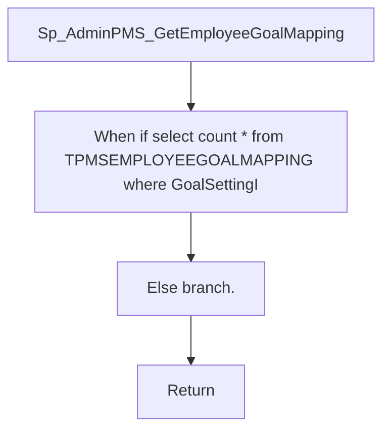

# Sp_AdminPMS_GetEmployeeGoalMapping

## What it does

Stored procedure `Sp_AdminPMS_GetEmployeeGoalMapping`. Reads `TPMSEMPLOYEEGOALMAPPING`. Calls no other procedure or function.

## Parameters

| Name | Direction | What it is for |
|---|---|---|
| `@GoalSettingId` | in | int |

## Call sequence

Calls no other procedures or functions.

## Callers

No other procedure or function calls this object.

## Nested

Calls no other procedures or functions.

## Steps

1. Script is `HRMS-DATABASE/HRMS/STOREPROCEDURE/Sp_AdminPMS_GetEmployeeGoalMapping.sql`.
2. When if((select count(*) from TPMSEMPLOYEEGOALMAPPING where GoalSettingId = @GoalSettingId and IsInitiated =1) =0)
3. Else branch.

## Tables

| Table | Read or write |
|---|---|
| `TPMSEMPLOYEEGOALMAPPING` | read |

## Flow

