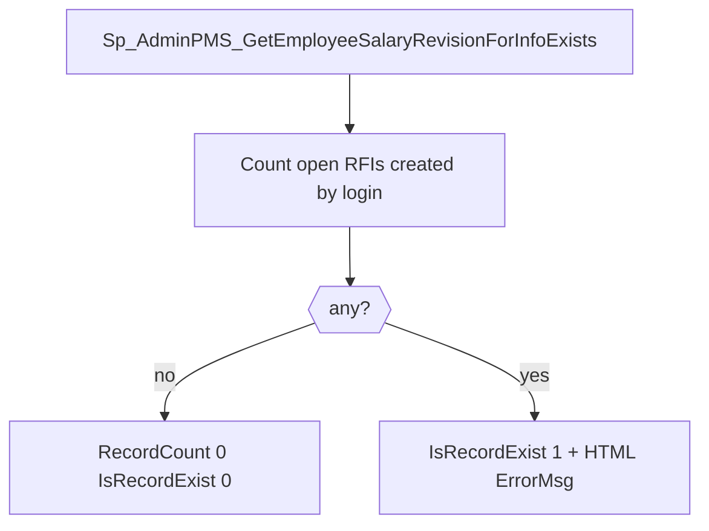

# Sp_AdminPMS_GetEmployeeSalaryRevisionForInfoExists

## What it does

Approve-gate helper for Salary Recommendations. Counts non-deleted RFI rows the logged-in employee created that are still unprocessed or unacknowledged. Returns `RecordCount`, `IsRecordExist` (`0`/`1`), and an HTML `ErrorMsg` listing pending `EmployeeName-Qn` items when any remain.

## Parameters

| Name | Direction | What it is for |
|---|---|---|
| `@AppraisalCycleId` | in | Assessment / cycle id |
| `@LoggedInEmpId` | in | Creator to match (`CreatedBy`) |

## Call sequence

Calls no other procedures or functions.

## Callers

No other procedure or function calls this object. `performanceAssessmentDAL.GetEmployeeSalaryRevisionForInfoExists` executes it before Approve.

## Nested

None.

## Steps

1. Script is `HRMS-DATABASE/HRMS/STOREPROCEDURE/Sp_AdminPMS_GetEmployeeSalaryRevisionForInfoExists.sql`.
2. Count `TPMSSalaryRevisionForMoreInfo` where `CreatedBy = @LoggedInEmpId` and (`IsProcessed = 0` OR `IsAcknowledged = 0`) and not deleted.
3. Build numbered employee-question list.
4. `SELECT` either empty success flags or `IsRecordExist = 1` with HTML message.

## Tables

| Table | Read or write |
|---|---|
| `TPMSSalaryRevisionForMoreInfo` | read |

## Flow

