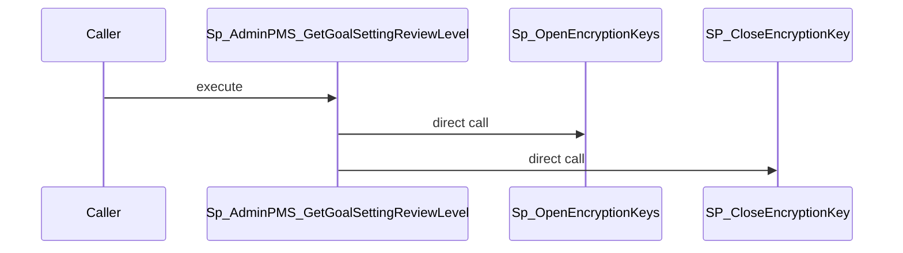
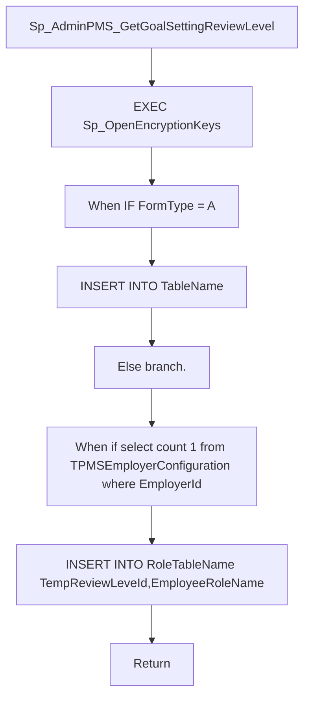

# Sp_AdminPMS_GetGoalSettingReviewLevel

## What it does

Stored procedure `Sp_AdminPMS_GetGoalSettingReviewLevel`. Reads `TWorkflowManagement`, `TWorkFlowBusinessUnits`, `TWorkFlowLocations`, `TPMSEmployerConfiguration`, `TEmployeeGoalSettingReviewLevelMaster`. Calls `Sp_OpenEncryptionKeys`, `SP_CloseEncryptionKey`.

## Parameters

| Name | Direction | What it is for |
|---|---|---|
| `@EmployerId` | in | Int |
| `@FormType` | in | varchar(1), default 'G' |

## Call sequence

## Callers

| Object | Kind | Page |
|---|---|---|
| `SP_ADMINPMS_GetEmployeeGoalDetails` | procedure | No page yet |
| `SP_PMS_GetCompetencyforSelfAppraisal` | procedure | No page yet |

## Nested

| Object | Kind | When | Page |
|---|---|---|---|
| `Sp_OpenEncryptionKeys` | procedure | direct call | [Sp_OpenEncryptionKeys](/docs/database/hrms/Sp_OpenEncryptionKeys) |
| `SP_CloseEncryptionKey` | procedure | direct call | [SP_CloseEncryptionKey](/docs/database/hrms/SP_CloseEncryptionKey) |

## Steps

1. Script is `HRMS-DATABASE/HRMS/STOREPROCEDURE/Sp_AdminPMS_GetGoalSettingReviewLevel.sql`.
2. EXEC Sp_OpenEncryptionKeys
3. When IF (@FormType = 'A')
4. INSERT INTO @TableName (
5. Else branch.
6. When if(select count(1) from TPMSEmployerConfiguration where EmployerId =@EmployerId and IsGoalFormWithWorkFlow=0)=1
7. INSERT INTO @RoleTableName(TempReviewLeveId,EmployeeRoleName)
8. Else branch.
9. INSERT INTO @TableName (
10. EXEC SP_CloseEncryptionKey

## Tables

| Table | Read or write |
|---|---|
| `TEmployeeGoalSettingReviewLevelMaster` | read |
| `TPMSEmployerConfiguration` | read |
| `TWorkFlowBusinessUnits` | read |
| `TWorkFlowLocations` | read |
| `TWorkflowManagement` | read |

## Flow

