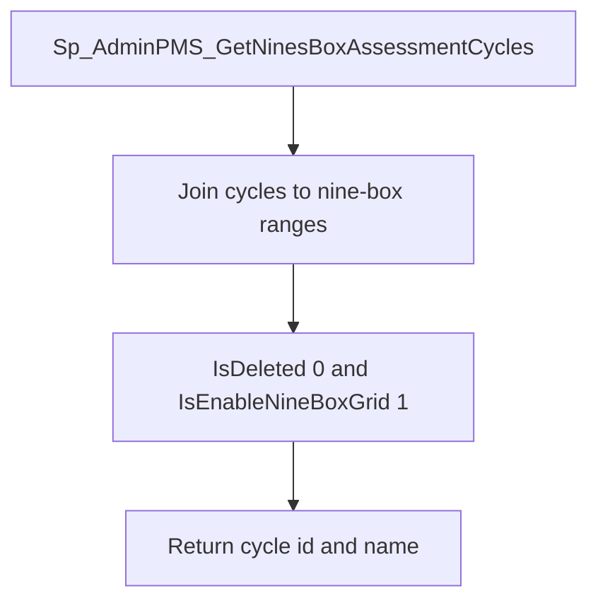

# Sp_AdminPMS_GetNinesBoxAssessmentCycles

## What it does

Returns distinct appraisal cycles for an employer that still have nine-box enabled and at least one row in `TPMS_AppraisalNineBoxGrid`. Used to fill the 9-Box Grid cycle dropdown.

## Parameters

| Name | Direction | What it is for |
|---|---|---|
| `@EmployerId` | in | Employer whose cycles are listed |

## Call sequence

Calls no other procedures or functions.

## Callers

No other procedure or function calls this object. Application callers include Core API `GetNinesBoxAssessmentCycles` and legacy `PerformanceAssessmentDAL.GetNinesBoxAssessmentCycles`.

## Nested

Calls no other procedures or functions.

## Steps

Script: `HRMS-DATABASE/HRMS/STOREPROCEDURE/Sp_AdminPMS_GetNinesBoxAssessmentCycles.sql`.

1. `SELECT DISTINCT` `AppraisalCycleId`, `CycleName` from `TPMSAppraisalCycles` inner join `TPMS_AppraisalNineBoxGrid` on `AppraisalCycleId`.
2. Filter `IsDeleted = 0`, `IsEnableNineBoxGrid = 1`, and `EmployerID = @EmployerId`.
3. Order by `AppraisalCycleId` descending.

## Tables

| Table | Read or write |
|---|---|
| `TPMSAppraisalCycles` | read |
| `TPMS_AppraisalNineBoxGrid` | read |

## Flow

