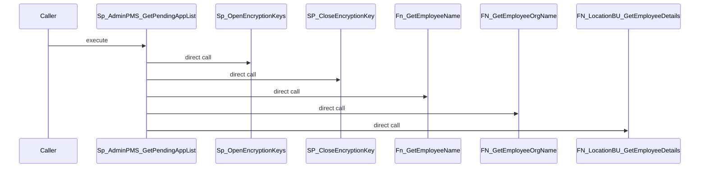
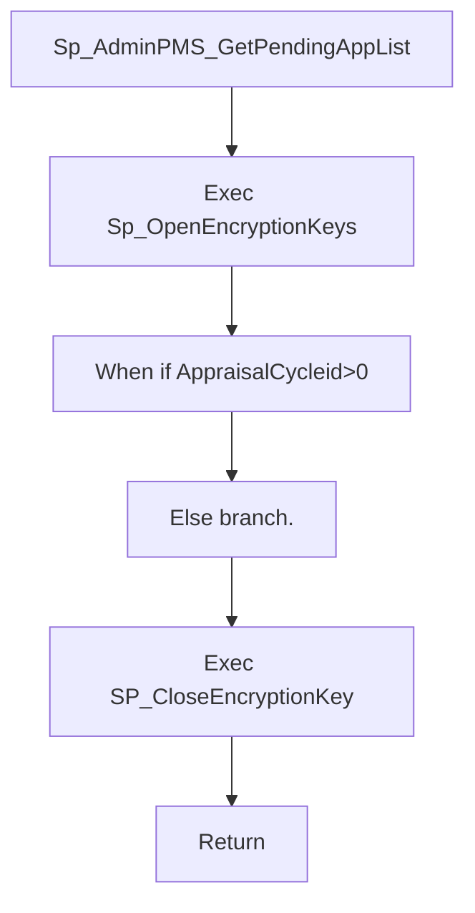

# Sp_AdminPMS_GetPendingAppList

## What it does

Stored procedure `Sp_AdminPMS_GetPendingAppList`. Reads `TEmployerDetails`, `TPMSAppraisalCycles`, `tEmployee`, `TRequestWorkflows`, `tpmsappraisalcycles`, `tpms_appraisalreviewfrequency`, `TPMSEmployeeAppraisalCycleMapping`, `TPMSEmployerConfiguration`, and others. Calls `Sp_OpenEncryptionKeys`, `SP_CloseEncryptionKey`, `Fn_GetEmployeeName`, `FN_GetEmployeeOrgName`, `FN_LocationBU_GetEmployeeDetails`.

## Parameters

| Name | Direction | What it is for |
|---|---|---|
| `@AppraisalCycleid` | in | Int, default 0 |
| `@GoalSettingId` | in | int, default 0 |
| `@ReviewFrequencyId` | in | int, default 0 |
| `@Employerid` | in | Int, default 0 |
| `@Employeeid` | in | Int, default 0 |

## Call sequence

## Callers

No other procedure or function calls this object.

## Nested

| Object | Kind | When | Page |
|---|---|---|---|
| `Sp_OpenEncryptionKeys` | procedure | direct call | [Sp_OpenEncryptionKeys](/docs/database/hrms/Sp_OpenEncryptionKeys) |
| `SP_CloseEncryptionKey` | procedure | direct call | [SP_CloseEncryptionKey](/docs/database/hrms/SP_CloseEncryptionKey) |
| `Fn_GetEmployeeName` | function | direct call | [Fn_GetEmployeeName](/docs/database/hrms/Fn_GetEmployeeName) |
| `FN_GetEmployeeOrgName` | function | direct call | [FN_GetEmployeeOrgName](/docs/database/hrms/FN_GetEmployeeOrgName) |
| `FN_LocationBU_GetEmployeeDetails` | function | direct call | [FN_LocationBU_GetEmployeeDetails](/docs/database/hrms/FN_LocationBU_GetEmployeeDetails) |

## Steps

1. Script is `HRMS-DATABASE/HRMS/STOREPROCEDURE/Sp_AdminPMS_GetPendingAppList.sql`.
2. Exec Sp_OpenEncryptionKeys
3. When if(@AppraisalCycleid>0)
4. Else branch.
5. Exec SP_CloseEncryptionKey

## Tables

| Table | Read or write |
|---|---|
| `TEmployee` | read |
| `TEmployerDetails` | read |
| `TORGChart` | read |
| `TPMSAppraisalCycles` | read |
| `TPMSEMPLOYEEGOALMAPPING` | read |
| `TPMSEmployeeAppraisalCycleMapping` | read |
| `TPMSEmployeeGoalSetting` | read |
| `TPMSEmployerConfiguration` | read |
| `TPMS_GoalSettingReviewFrequency` | read |
| `TRequestWorkflows` | read |
| `Temployeeinfo` | read |
| `tEmployee` | read |
| `tpms_appraisalreviewfrequency` | read |
| `tpmsappraisalcycles` | read |

## Flow

