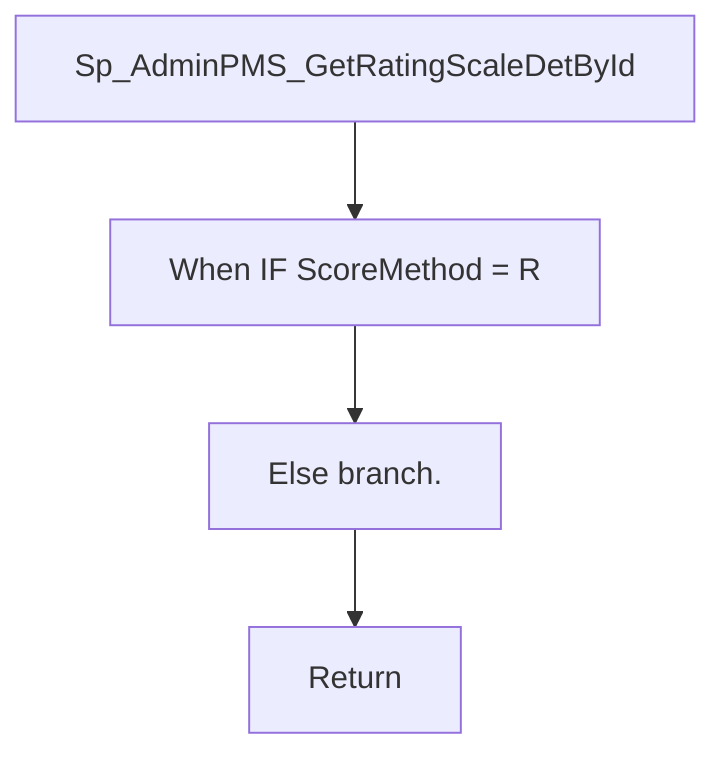

# Sp_AdminPMS_GetRatingScaleDetById

## What it does

Stored procedure `Sp_AdminPMS_GetRatingScaleDetById`. Reads `TPMSRatingMaster`, `TPMSWeightageMaster`, `TPMSGOALCATEGORYOUTCOMEDEATILS`, `TPMSGOALCATEGORY`, `TPMSGOALCATEGORYDETAILS`. Calls no other procedure or function.

## Parameters

| Name | Direction | What it is for |
|---|---|---|
| `@RatingId` | in | Int |
| `@EmployerId` | in | Int |
| `@ScoreMethod` | in | varchar(1) |

## Call sequence

Calls no other procedures or functions.

## Callers

No other procedure or function calls this object.

## Nested

Calls no other procedures or functions.

## Steps

1. Script is `HRMS-DATABASE/HRMS/STOREPROCEDURE/Sp_AdminPMS_GetRatingScaleDetById.sql`.
2. When IF(@ScoreMethod ='R')
3. Else branch.

## Tables

| Table | Read or write |
|---|---|
| `TPMSGOALCATEGORY` | read |
| `TPMSGOALCATEGORYDETAILS` | read |
| `TPMSGOALCATEGORYOUTCOMEDEATILS` | read |
| `TPMSRatingMaster` | read |
| `TPMSWeightageMaster` | read |

## Flow

