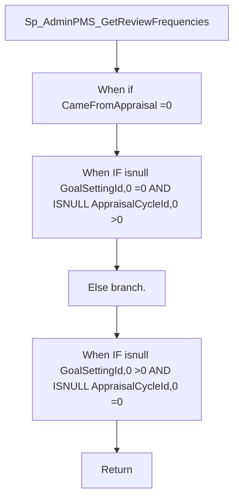

# Sp_AdminPMS_GetReviewFrequencies

## What it does

Stored procedure `Sp_AdminPMS_GetReviewFrequencies`. Reads `tpmsappraisalcycles`, `TPMS_AppraisalReviewFrequency`, `tpmsemployeegoalsetting`, `TPMS_GoalSettingReviewFrequency`. Calls no other procedure or function.

## Parameters

| Name | Direction | What it is for |
|---|---|---|
| `@GoalSettingId` | in | int, default 0 |
| `@AppraisalCycleId` | in | int, default 0 |
| `@CameFromAppraisal` | in | bit, default 0 |

## Call sequence

Calls no other procedures or functions.

## Callers

No other procedure or function calls this object.

## Nested

Calls no other procedures or functions.

## Steps

1. Script is `HRMS-DATABASE/HRMS/STOREPROCEDURE/Sp_AdminPMS_GetReviewFrequencies.sql`.
2. When if(@CameFromAppraisal =0)
3. When IF(isnull(@GoalSettingId,0)=0 AND ISNULL(@AppraisalCycleId,0)>0)
4. Else branch.
5. When IF(isnull(@GoalSettingId,0)>0 AND ISNULL(@AppraisalCycleId,0)=0)

## Tables

| Table | Read or write |
|---|---|
| `TPMS_AppraisalReviewFrequency` | read |
| `TPMS_GoalSettingReviewFrequency` | read |
| `tpmsappraisalcycles` | read |
| `tpmsemployeegoalsetting` | read |

## Flow

