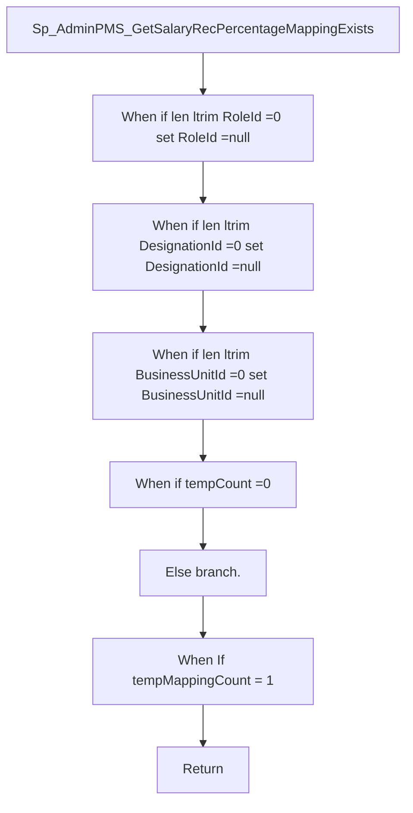

# Sp_AdminPMS_GetSalaryRecPercentageMappingExists

## What it does

Stored procedure `Sp_AdminPMS_GetSalaryRecPercentageMappingExists`. Reads `TPMSSalaryRecPercentageForMapping`, `TPMSSalaryRecPercentageForBU`, `TPMSSalaryRecPercentageForRole`, `TPMSSalaryRecPercentageForDesignation`. Calls no other procedure or function.

## Parameters

| Name | Direction | What it is for |
|---|---|---|
| `@AppraisalCycleId` | in | Int |
| `@RatingId` | in | Int |
| `@EmployerId` | in | Int |
| `@DesignationId` | in | Varchar(4000) |
| `@RoleId` | in | Varchar(4000) |
| `@BusinessUnitId` | in | Varchar(4000) |

## Call sequence

Calls no other procedures or functions.

## Callers

No other procedure or function calls this object.

## Nested

Calls no other procedures or functions.

## Steps

1. Script is `HRMS-DATABASE/HRMS/STOREPROCEDURE/Sp_AdminPMS_GetSalaryRecPercentageMappingExists.sql`.
2. When if(len(ltrim(@RoleId)) =0) set @RoleId =null
3. When if(len(ltrim(@DesignationId)) =0) set @DesignationId =null
4. When if(len(ltrim(@BusinessUnitId)) =0) set @BusinessUnitId =null
5. When if(@tempCount =0)
6. Else branch.
7. When If @tempMappingCount = 1
8. Else branch.

## Tables

| Table | Read or write |
|---|---|
| `TPMSSalaryRecPercentageForBU` | read |
| `TPMSSalaryRecPercentageForDesignation` | read |
| `TPMSSalaryRecPercentageForMapping` | read |
| `TPMSSalaryRecPercentageForRole` | read |

## Flow

