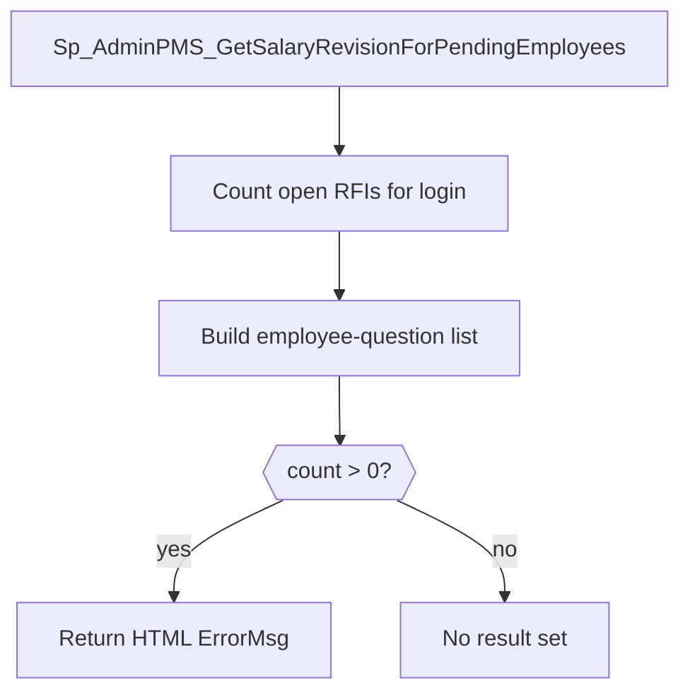

# Sp_AdminPMS_GetSalaryRevisionForPendingEmployees

## What it does

Counts unprocessed, non-deleted RFI rows on `TPMSSalaryRevisionForMoreInfo` for an appraisal cycle where the logged-in employee is the current owner (`InitiatorId` when `ReviewLevelTo = 0`, else `ManagerId`) or the creator. When any exist, returns one HTML `ErrorMsg` listing `EmployeeName-Qn` items for the Salary Recommendations pending-RFI banner.

## Parameters

| Name | Direction | What it is for |
|---|---|---|
| `@AppraisalCycleId` | in | Assessment / cycle id |
| `@LoggedInEmpId` | in | Login employee to match owner or creator |

## Call sequence

Calls no other procedures or functions.

## Callers

No other procedure or function calls this object. `performanceAssessmentDAL.GetSalaryRevisionForPendingEmployees` executes it after the grid loads.

## Nested

None.

## Steps

1. Script is `HRMS-DATABASE/HRMS/STOREPROCEDURE/Sp_AdminPMS_GetSalaryRevisionForPendingEmployees.sql`.
2. Count matching `TPMSSalaryRevisionForMoreInfo` rows (`IsProcessed = 0`, `IsDeleted = 0`).
3. Build comma-separated numbered employee-question labels via `FOR XML PATH`.
4. If count > 0, `SELECT` the HTML `ErrorMsg`.

## Tables

| Table | Read or write |
|---|---|
| `TPMSSalaryRevisionForMoreInfo` | read |

## Flow

