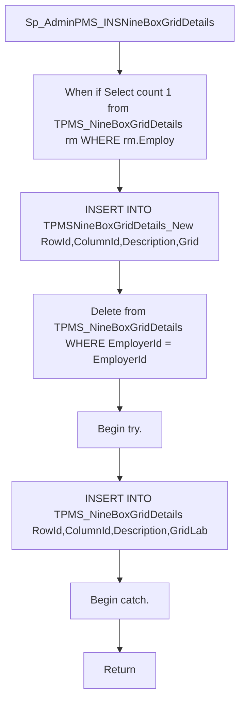

# Sp_AdminPMS_INSNineBoxGridDetails

## What it does

Stored procedure `Sp_AdminPMS_INSNineBoxGridDetails`. Writes `TPMS_NineBoxGridDetails`. Calls no other procedure or function.

## Parameters

| Name | Direction | What it is for |
|---|---|---|
| `@EmployerId` | in | INT, default 10 |
| `@NineBoxGridDetails` | in | [dbo] |

## Call sequence

Calls no other procedures or functions.

## Callers

No other procedure or function calls this object.

## Nested

Calls no other procedures or functions.

## Steps

1. Script is `HRMS-DATABASE/HRMS/STOREPROCEDURE/Sp_AdminPMS_INSNineBoxGridDetails.sql`.
2. When if((Select count(1) from TPMS_NineBoxGridDetails rm WHERE rm.EmployerId = @EmployerId)>0)
3. INSERT INTO @TPMSNineBoxGridDetails_New(RowId,ColumnId,Description,GridLabel,GridLabelDefination,GridSuggestiveAction,GridColorCode,EmployerId)
4. Delete from TPMS_NineBoxGridDetails WHERE EmployerId = @EmployerId
5. Begin try.
6. INSERT INTO TPMS_NineBoxGridDetails(RowId,ColumnId,Description,GridLabel,GridLabelDefination,GridSuggestiveAction,GridColorCode,EmployerId)
7. Begin catch.
8. When IF(@lv_IsRecordExist=1)
9. INSERT INTO TPMS_NineBoxGridDetails(RowId,ColumnId,Description,GridLabel,GridLabelDefination,GridSuggestiveAction,GridColorCode,EmployerId)

## Tables

| Table | Read or write |
|---|---|
| `TPMS_NineBoxGridDetails` | read and write |

## Flow

