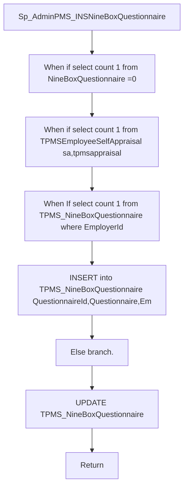

# Sp_AdminPMS_INSNineBoxQuestionnaire

## What it does

Stored procedure `Sp_AdminPMS_INSNineBoxQuestionnaire`. Writes `TPMS_NineBoxQuestionnaire`. Reads `TPMSEmployeeSelfAppraisal`. Calls no other procedure or function.

## Parameters

| Name | Direction | What it is for |
|---|---|---|
| `@EmployerId` | in | INT, default 10 |
| `@NineBoxQuestionnaire` | in | [dbo] |
| `@CreatedBy` | in | int |

## Call sequence

Calls no other procedures or functions.

## Callers

No other procedure or function calls this object.

## Nested

Calls no other procedures or functions.

## Steps

1. Script is `HRMS-DATABASE/HRMS/STOREPROCEDURE/Sp_AdminPMS_INSNineBoxQuestionnaire.sql`.
2. When if((select count(1) from @NineBoxQuestionnaire)=0)
3. When if((select count(1) from TPMSEmployeeSelfAppraisal sa,tpmsappraisalcycles ac, TPMSEmployerConfiguration ed
4. When If ((select count(1) from TPMS_NineBoxQuestionnaire where EmployerId=@EmployerId and IsActive=1 and upper(Questionnaire) = upper(@lv_Questionnaire))=0)
5. INSERT into TPMS_NineBoxQuestionnaire(QuestionnaireId,Questionnaire,EmployerId,IsActive,CreatedBy,CreatedDate,UpdatedBy,UpdatedDate)
6. Else branch.
7. UPDATE TPMS_NineBoxQuestionnaire

## Tables

| Table | Read or write |
|---|---|
| `TPMSEmployeeSelfAppraisal` | read |
| `TPMS_NineBoxQuestionnaire` | read and write |

## Flow

