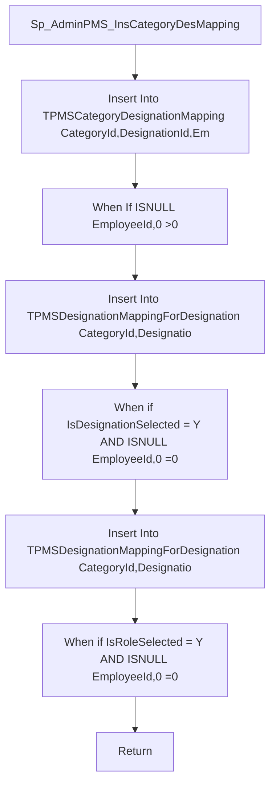

# Sp_AdminPMS_InsCategoryDesMapping

## What it does

Stored procedure `Sp_AdminPMS_InsCategoryDesMapping`. Writes `TPMSCategoryDesignationMapping`, `TPMSDesignationMappingForDesignation`, `TPMSDesignationMappingForRole`, `TPMSDesignationMappingForBU`, `TPMSEmployeeGoalSettingTemplate`, `TPMSEmployeeGoalSettingDetails`. Reads `temployeeinfo`, `TPMSEmployeeGoalFormSettingDetails`. Calls no other procedure or function.

## Parameters

| Name | Direction | What it is for |
|---|---|---|
| `@CategoryId` | in | Int |
| `@DesignationId` | in | Varchar(4000) |
| `@EmployerId` | in | Int |
| `@CreatedBy` | in | Int |
| `@RoleId` | in | Varchar(4000), default NULL |
| `@BusinessUnitId` | in | Varchar(4000), default NULL |
| `@IsRoleSelected` | in | varchar(1), default NULL |
| `@IsDesignationSelected` | in | varchar(1), default NULL |
| `@IsBusinessUnitSelected` | in | varchar(1), default NULL |
| `@AppraisalCycleId` | in | int, default NULL |
| `@GoalSettingId` | in | int, default NULL |
| `@FormType` | in | varchar(1), default NULL |
| `@EmployeeId` | in | INT, default 0 |

## Call sequence

Calls no other procedures or functions.

## Callers

| Object | Kind | Page |
|---|---|---|
| `Sp_AdminPMS_UpdCategoryDesMapping` | procedure | [Sp_AdminPMS_UpdCategoryDesMapping](/docs/database/hrms/Sp_AdminPMS_UpdCategoryDesMapping) |
| `Sp_UpdatePMSCategoryDesignationMapping` | procedure | No page yet |

## Nested

Calls no other procedures or functions.

## Steps

1. Script is `HRMS-DATABASE/HRMS/STOREPROCEDURE/Sp_AdminPMS_InsCategoryDesMapping.sql`.
2. Insert Into TPMSCategoryDesignationMapping(CategoryId,DesignationId,EmployerId,CreatedBy,CreatedDate,IsRoleSelected,IsDesignationSelected,IsBusinessUnitSelected,AppraisalCycleId,Go
3. When If(ISNULL(@EmployeeId,0)>0)
4. Insert Into TPMSDesignationMappingForDesignation(CategoryId,DesignationId,AppraisalCycleId, GoalSettingId)
5. When if(@IsDesignationSelected ='Y' AND ISNULL(@EmployeeId,0)=0)
6. Insert Into TPMSDesignationMappingForDesignation(CategoryId,DesignationId,AppraisalCycleId, GoalSettingId)
7. When if(@IsRoleSelected ='Y' AND ISNULL(@EmployeeId,0)=0)
8. Insert Into TPMSDesignationMappingForRole(CategoryId,RoleId,AppraisalCycleId,GoalSettingId)
9. When if(@IsBusinessUnitSelected ='Y' AND ISNULL(@EmployeeId,0)=0)
10. Insert Into TPMSDesignationMappingForBU(CategoryId,BusinessUnitId,AppraisalCycleId,GoalSettingId)
11. When if(@GoalSettingId>0)
12. INSERT INTO TPMSEmployeeGoalSettingTemplate (GoalSettingId, FormId)
13. INSERT INTO TPMSEmployeeGoalSettingDetails (GoalSettingId, OptionalField1, OptionalField2, OptionalField3, OptionalField4, OptionalField5, OptionalField6, OptionalField7,OptionalFi

## Tables

| Table | Read or write |
|---|---|
| `TPMSCategoryDesignationMapping` | write |
| `TPMSDesignationMappingForBU` | write |
| `TPMSDesignationMappingForDesignation` | write |
| `TPMSDesignationMappingForRole` | write |
| `TPMSEmployeeGoalFormSettingDetails` | read |
| `TPMSEmployeeGoalSettingDetails` | write |
| `TPMSEmployeeGoalSettingTemplate` | write |
| `temployeeinfo` | read |

## Flow

