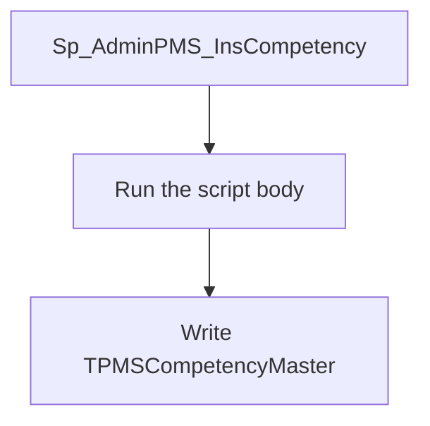

# Sp_AdminPMS_InsCompetency

## What it does

Inserts a competency dictionary row when the name is not already used for that employer.

## Parameters

| Name | Direction | What it is for |
|---|---|---|
| `@CompetencyName` | in | Competency Name |
| `@CompetencyDescription` | in | Competency Description |
| `@EmployerId` | in | Employer Id |
| `@CreatedBy` | in | Created By |
| `@IsActive` | in | Is Active |

## Call sequence

Calls no other procedures or functions.

## Callers

No other procedure or function calls this object.

## Nested

Calls no other procedures or functions.

## Steps

Script: `HRMS-DATABASE/HRMS/STOREPROCEDURE/Sp_AdminPMS_InsCompetency.sql`.

1. If (Select count(1) from TPMSCompetencyMaster Where EmployerId=@EmployerId And Upper(CompetencyName)=Upper(@CompetencyName) And IsDeleted=0)>0
2. Select 0 ErrorCode
3. Insert Into TPMSCompetencyMaster(CompetencyName,CompetencyDescription,EmployerId,IsActive,IsDeleted,CreatedBy,CreatedDate)
4. Select 1 ErrorCode

## Tables

| Table | Read or write |
|---|---|
| `TPMSCompetencyMaster` | read/write |

## Flow

