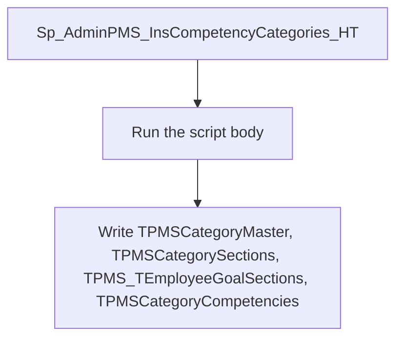

# Sp_AdminPMS_InsCompetencyCategories_HT

## What it does

Inserts or updates a confirmation or appraisal form. It writes the category header, competency sections, KRA sections, and optional goal-form layout, and returns the new category id.

## Parameters

| Name | Direction | What it is for |
|---|---|---|
| `@CategoryName` | in | Category Name |
| `@CategoryDescription` | in | Category Description |
| `@EmployerId` | in | Employer Id |
| `@IsActive` | in | Is Active |
| `@UDTTPMSCategoryCompetencies` | in | UDTTPMSCategory Competencies. Table-valued parameter |
| `@CreatedBy` | in | Created By |
| `@CategoryId` | in | Category Id. Default NULL |
| `@AppraisalType` | in | Appraisal Type. Default NULL |
| `@UDTTPMSCategoryKRAs` | in | UDTTPMSCategory KRAs. Table-valued parameter |
| `@WeightageCalculation` | in | Weightage Calculation. Default NULL |
| `@CompetencySectionWeightage` | in | Competency Section Weightage. Default NULL |
| `@KRASectionWeightage` | in | KRASection Weightage. Default NULL |
| `@FormType` | in | Form Type. Default 'P' |
| `@NoOfOptionalFields` | in | No Of Optional Fields. Default 0 |
| `@UDTTEmployeeGoalSettingDetails` | in | UDTTEmployee Goal Setting Details. Table-valued parameter |
| `@IsKRACategeory` | in | Is KRACategeory. Default 0 |
| `@IsDefineKRA` | in | Is Define KRA. Default 0 |
| `@ISKRADescription` | in | ISKRADescription. Default 0 |
| `@ISKPADescription` | in | ISKPADescription. Default 0 |
| `@IsAssignedTarget` | in | Is Assigned Target. Default 0 |
| `@UDTTEmployeeGoalSections` | in | UDTTEmployee Goal Sections. Table-valued parameter |
| `@GoalSectionWeightage` | in | Goal Section Weightage. Default 0 |
| `@DefSectionName` | in | Def Section Name. Default NULL |
| `@NewCategoryId` | out | New Category Id |
| `@UDTTCategoryMasterGoalFormData` | in | UDTTCategory Master Goal Form Data. Table-valued parameter |
| `@AdditionalContent` | in | Additional Content. Default NULL |
| `@NoOfCoumnsToFixedGoalFormGrid` | in | No Of Coumns To Fixed Goal Form Grid. Default 0 |
| `@IsMeasurementCriteriaChecked` | in | Is Measurement Criteria Checked. Default 0 |
| `@MeasurementCriteriaValue` | in | Measurement Criteria Value. Default null |
| `@CumulativeAchievedMinPercentage` | in | Cumulative Achieved Min Percentage. Default NULL |
| `@CumulativeAchievedMaxPercentage` | in | Cumulative Achieved Max Percentage. Default NULL |

## Call sequence

Calls no other procedures or functions.

## Callers

No other procedure or function calls this object.

## Nested

Calls no other procedures or functions.

## Steps

Script: `HRMS-DATABASE/HRMS/STOREPROCEDURE/Sp_AdminPMS_InsCompetencyCategories_HT.sql`.

1. select @lv_IsFormPreDefined=IsFormPreDefined from TPMSEmployerConfiguration where employerid=@EmployerId
2. if(len(@CategoryName)=0)
3. Select 1 ErrorCode,'Please enter Form Name.' ErrorMsg
4. Return
5. If(@AppraisalType ='C')
6. if ((SELECT COUNT(1) FROM @UDTTPMSCategoryCompetencies) = 0)
7. Select 1 ErrorCode,'Competency Section Details not found.' ErrorMsg
8. Return
9. If(@AppraisalType ='G' AND @IsMeasurementCriteriaChecked >0 AND @MeasurementCriteriaValue>0)
10. if ((SELECT COUNT(1) FROM @UDTTPMSCategoryKRAs) = 0)
11. Select 1 ErrorCode,'KRA Details not found.' ErrorMsg
12. Return

## Tables

| Table | Read or write |
|---|---|
| `TPMSCategoryMaster` | read/write |
| `TPMSCategorySections` | read/write |
| `TPMS_TEmployeeGoalSections` | write |
| `TPMSCategoryCompetencies` | write |
| `TPMSEmployeeGoalFormSettingDetails` | read/write |
| `TPMSCategoryGoalKRAs` | write |
| `TPMSCategoryMasterGoalFormData` | read/write |
| `TPMSEmployeeGoalFormDataDetails` | read/write |
| `TPMSEmployerConfiguration` | read |
| `TPMSGOALCATEGORY` | read |
| `TPMSGOALCATEGORYDETAILS` | read |
| `TPMSEmployeeGoalMapping` | read |
| `tpmsappraisalcycles` | read |
| `TPMSEmployeeAppraisalCycleMapping` | read |
| `TCMSEmployeeConfirmation` | read |

## Flow

