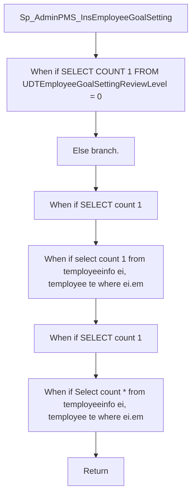

# Sp_AdminPMS_InsEmployeeGoalSetting

## What it does

Stored procedure `Sp_AdminPMS_InsEmployeeGoalSetting`. Writes `TPMSEmployeeGoalSettingReviewLevel`, `TPMSGoalSettingIncludeNewJoinees`, `TPMS_GoalSettingReviewFrequency`, `TPMSEmployeeGoalSetting`, `TPMSEmployeeGoalMapping`. Reads `temployeeinfo`, `TEmployeeOrgBusinessHead`, `TPMSEmployerConfiguration`, `TWorkflowManagement`, `tworkflowmanagement`. Calls no other procedure or function.

## Parameters

| Name | Direction | What it is for |
|---|---|---|
| `@GoalPeriodName` | in | Varchar(500) |
| `@StartDate` | in | Date |
| `@EndDate` | in | Date |
| `@ValidTillDate` | in | Date |
| `@EmployerId` | in | Int |
| `@IsActive` | in | Bit |
| `@CreatedBy` | in | Int |
| `@UDTEmployeeGoalSettingReviewLevel` | in | UDTEmployeeGoalSettingReviewLevel |
| `@ReviewLevelCount` | in | int |
| `@GoalSettingId` | in | int, default 0 |
| `@UDTTAppraisalReviewFrequency` | in | UDTTAppraisalReviewFrequency |
| `@GoalType` | in | char, default 'P' |
| `@IncludeNewJoinees` | in | bit, default 0 |
| `@NoOfDaysForFormActiveDate` | in | int, default 0 |
| `@NoOfDaysForFormSubmittedDate` | in | int, default 0 |
| `@NoOfDaysForFormSubmittedDateL1` | in | int, default 0 |
| `@NoOfDaysForFormSubmittedDateL2` | in | int, default 0 |
| `@NoOfDaysForFormSubmittedDateL3` | in | int, default 0 |
| `@NoOfDaysForFormSubmittedDateL4` | in | int, default 0 |
| `@ExcludeEmployees` | in | bit, default 0 |
| `@ExcludeEmployeesGoalPeriodDate` | in | Date, default @EndDate |
| `@OnGoingMonth` | in | char, default 'S' |
| `@ReviewFrequencyType` | in | char, default 'M' |

## Call sequence

Calls no other procedures or functions.

## Callers

No other procedure or function calls this object.

## Nested

Calls no other procedures or functions.

## Steps

1. Script is `HRMS-DATABASE/HRMS/STOREPROCEDURE/Sp_AdminPMS_InsEmployeeGoalSetting.sql`.
2. When if ((SELECT COUNT(1) FROM @UDTEmployeeGoalSettingReviewLevel) = 0)
3. Else branch.
4. When if((SELECT count(1)
5. When if((select count(1) from temployeeinfo ei, temployee te where ei.employeeid=te.employeeid and reviewmanager is null and ei.employerid=@EmployerId and isactive='
6. When if((SELECT count(1)
7. When if((Select count(*) from temployeeinfo ei, temployee te where ei.employeeid=te.employeeid and ei.employerid=@EmployerId and isactive='Y' and ei.BusinessUnitId n
8. When if ((Select count(1) From TPMSEmployeeGoalSetting Where Employerid=@Employerid And Upper(GoalPeriodName)=Upper(@GoalPeriodName) AND @GoalSettingId=0) ) > 0
9. When IF (ISNULL(@GoalSettingId, 0) > 0)
10. When If ((Select count(*) From TPMSEmployeeGoalSetting Where GoalSettingId= @GoalSettingId and IsGoalFreezed=1)=1)
11. Update TPMSEmployeeGoalSetting
12. Delete from TPMSEmployeeGoalSettingReviewLevel where GoalSettingId=@GoalSettingId;
13. INSERT INTO TPMSEmployeeGoalSettingReviewLevel (GoalSettingId, ReviewLevel1, ReviewLevel2, ReviewLevel3, ReviewLevel4,ReviewLevel5)
14. Delete from TPMSGoalSettingIncludeNewJoinees where GoalSettingId=@GoalSettingId;
15. INSERT INTO TPMSGoalSettingIncludeNewJoinees (
16. When if(((select count(1) from TPMS_GoalSettingReviewFrequency where GoalSettingId=@GoalSettingId) !=
17. Delete from TPMS_GoalSettingReviewFrequency where GoalSettingId=@GoalSettingId;
18. INSERT INTO TPMS_GoalSettingReviewFrequency (
19. Update TPMSEmployeeGoalSetting
20. Update TPMSEmployeeGoalMapping
21. Else branch.
22. UPDATE TPMS_GoalSettingReviewFrequency
23. Else branch.
24. Insert into TPMSEmployeeGoalSetting
25. When IF (ISNULL(@GoalSettingId, 0) > 0)
26. When if(select IsGoalFormWithWorkFlow from TPMSEmployerConfiguration where employerid=@EmployerId) =0
27. INSERT INTO TPMSEmployeeGoalSettingReviewLevel (GoalSettingId, ReviewLevel1, ReviewLevel2, ReviewLevel3, ReviewLevel4,ReviewLevel5)
28. Else branch.
29. INSERT INTO @TableName (
30. Further statements continue in the script.

## Tables

| Table | Read or write |
|---|---|
| `TEmployeeOrgBusinessHead` | read |
| `TPMSEmployeeGoalMapping` | read and write |
| `TPMSEmployeeGoalSetting` | read and write |
| `TPMSEmployeeGoalSettingReviewLevel` | read and write |
| `TPMSEmployerConfiguration` | read |
| `TPMSGoalSettingIncludeNewJoinees` | read and write |
| `TPMS_GoalSettingReviewFrequency` | read and write |
| `TWorkflowManagement` | read |
| `temployeeinfo` | read |
| `tworkflowmanagement` | read |

## Flow

