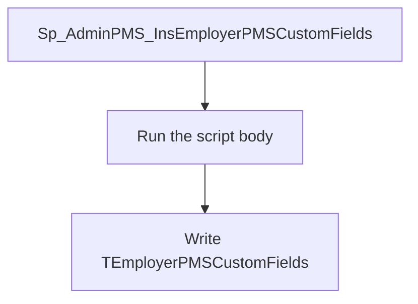

# Sp_AdminPMS_InsEmployerPMSCustomFields

## What it does

Inserts or updates the employer-specific labels for competency and KRA fields.

## Parameters

| Name | Direction | What it is for |
|---|---|---|
| `@EmployerId` | in | Employer Id |
| `@CompetencyName` | in | Competency Name |
| `@CompetencyDefinition` | in | Competency Definition |
| `@KRACategoryName` | in | KRACategory Name |
| `@DefineKRA` | in | Define KRA |
| `@KRADescription` | in | KRADescription |
| `@KPADescription` | in | KPADescription |
| `@AssignedTarget` | in | Assigned Target |
| `@CreatedBy` | in | Created By |

## Call sequence

Calls no other procedures or functions.

## Callers

No other procedure or function calls this object.

## Nested

Calls no other procedures or functions.

## Steps

Script: `HRMS-DATABASE/HRMS/STOREPROCEDURE/Sp_AdminPMS_InsEmployerPMSCustomFields.sql`.

1. If isnull(@EmployerId,0)=0
2. Select 1 ErrorCode
3. if((select count(*) from TEmployerPMSCustomFields where EmployerId=@EmployerId) =0)
4. Insert into TEmployerPMSCustomFields(
5. UPDATE TEmployerPMSCustomFields
6. Select 0 ErrorCode

## Tables

| Table | Read or write |
|---|---|
| `TEmployerPMSCustomFields` | read/write |

## Flow

