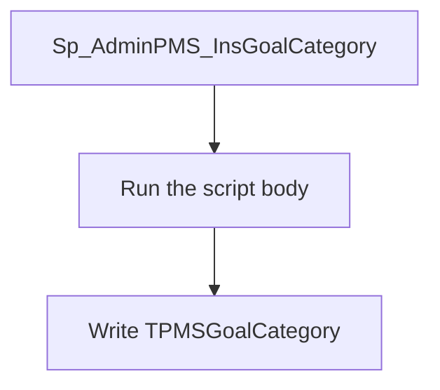

# Sp_AdminPMS_InsGoalCategory

## What it does

Inserts a KRA or goal category for an employer, including whether measure criteria are used.

## Parameters

| Name | Direction | What it is for |
|---|---|---|
| `@CategoryName` | in | Category Name |
| `@Employerid` | in | Employerid |
| `@IsActive` | in | Is Active |
| `@CreatedBy` | in | Created By |
| `@IsMeasureValAvailable` | in | Is Measure Val Available. Default 0 |
| `@MeasurementValue` | in | Measurement Value. Default 0 |
| `@CategoryType` | in | Category Type. Default 'K' |

## Call sequence

Calls no other procedures or functions.

## Callers

No other procedure or function calls this object.

## Nested

Calls no other procedures or functions.

## Steps

Script: `HRMS-DATABASE/HRMS/STOREPROCEDURE/Sp_AdminPMS_InsGoalCategory.sql`.

1. Select @CategoryId =Categoryid From TPMSGoalCategory Where Employerid=@Employerid And Upper(CategoryName)=Upper(@CategoryName) And IsDeleted=0;
2. If (@CategoryId)>0
3. Select 1 ErrorCode
4. Insert into TPMSGoalCategory(CategoryName,Employerid,IsActive,IsDeleted,CreateDate,CreatedBy,
5. Select 0 ErrorCode

## Tables

| Table | Read or write |
|---|---|
| `TPMSGoalCategory` | read/write |

## Flow

