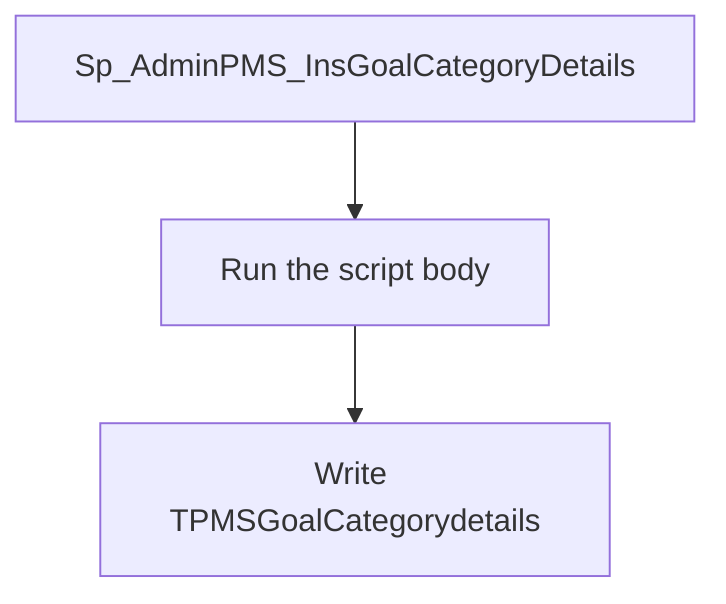

# Sp_AdminPMS_InsGoalCategoryDetails

## What it does

Inserts one goal-dictionary or KRA-dictionary detail row under a category.

## Parameters

| Name | Direction | What it is for |
|---|---|---|
| `@Categoryid` | in | Categoryid |
| `@IsActive` | in | Is Active |
| `@CreatedBy` | in | Created By |
| `@DefineKRA` | in | Define KRA. Default NULL |
| `@KRADescription` | in | KRADescription. Default NULL |
| `@KPADescription` | in | KPADescription. Default NULL |
| `@AssignedTarget` | in | Assigned Target. Default NULL |
| `@MesCriteriaField1` | in | Mes Criteria Field1. Default NULL |
| `@MesCriteriaField2` | in | Mes Criteria Field2. Default NULL |
| `@MesCriteriaField3` | in | Mes Criteria Field3. Default NULL |
| `@MesCriteriaField4` | in | Mes Criteria Field4. Default NULL |
| `@MesCriteriaField5` | in | Mes Criteria Field5. Default NULL |
| `@GoalName` | in | Goal Name. Default null |
| `@GoalDescription` | in | Goal Description. Default null |

## Call sequence

Calls no other procedures or functions.

## Callers

No other procedure or function calls this object.

## Nested

Calls no other procedures or functions.

## Steps

Script: `HRMS-DATABASE/HRMS/STOREPROCEDURE/Sp_AdminPMS_InsGoalCategoryDetails.sql`.

1. Select @tempCount =count(*) From TPMSGoalCategory Where Categoryid= @CategoryId And IsDeleted=0;
2. If (@tempCount)>0
3. if(@DefineKRA is not null or @KRADescription is not null or @KPADescription is not null or @AssignedTarget is not null )
4. Insert into TPMSGoalCategorydetails(Categoryid, IsDeleted, CreatedBy, CreatedDate, ModifiedBy, ModifiedDate,
5. Select 1 ErrorCode
6. Select 0 ErrorCode

## Tables

| Table | Read or write |
|---|---|
| `TPMSGoalCategorydetails` | write |
| `TPMSGoalCategory` | read |

## Flow

