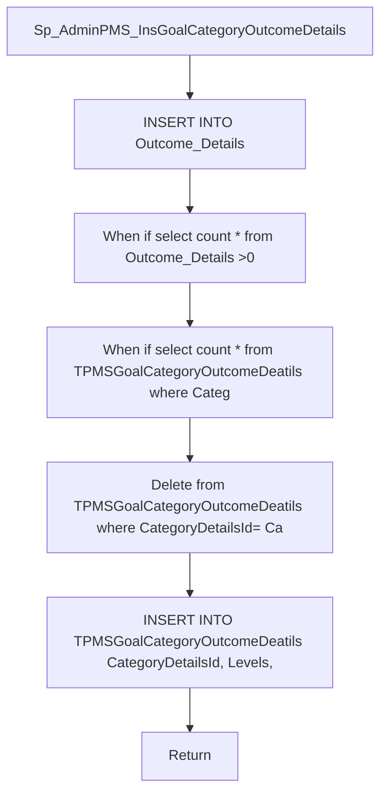

# Sp_AdminPMS_InsGoalCategoryOutcomeDetails

## What it does

Stored procedure `Sp_AdminPMS_InsGoalCategoryOutcomeDetails`. Writes `TPMSGoalCategoryOutcomeDeatils`. Calls no other procedure or function.

## Parameters

| Name | Direction | What it is for |
|---|---|---|
| `@CategoryDetailId` | in | Int |
| `@CreatedBy` | in | Int |
| `@OutcomeDetails` | in | varchar(MAX) |

## Call sequence

Calls no other procedures or functions.

## Callers

No other procedure or function calls this object.

## Nested

Calls no other procedures or functions.

## Steps

1. Script is `HRMS-DATABASE/HRMS/STOREPROCEDURE/Sp_AdminPMS_InsGoalCategoryOutcomeDetails.sql`.
2. INSERT INTO @Outcome_Details
3. When if((select count(*) from @Outcome_Details)>0)
4. When if((select count(*) from TPMSGoalCategoryOutcomeDeatils where CategoryDetailsId=@CategoryDetailId)>0)
5. Delete from TPMSGoalCategoryOutcomeDeatils where CategoryDetailsId=@CategoryDetailId;
6. INSERT INTO TPMSGoalCategoryOutcomeDeatils (CategoryDetailsId, Levels, MinRating, MaxRating, CreatedBy, CreatedDate, MeasureValue, OutcomeValue,RatingColorCode)

## Tables

| Table | Read or write |
|---|---|
| `TPMSGoalCategoryOutcomeDeatils` | read and write |

## Flow

