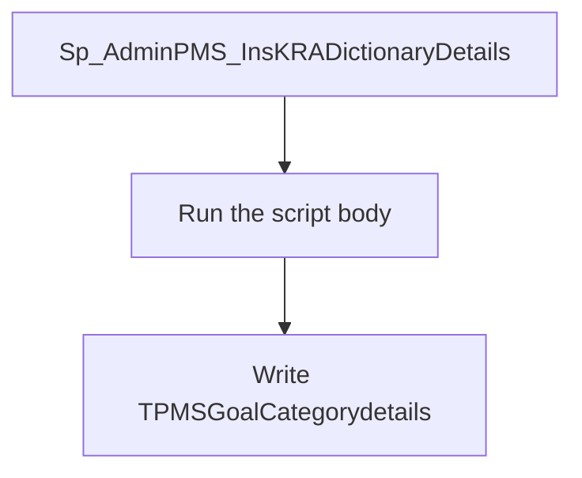

# Sp_AdminPMS_InsKRADictionaryDetails

## What it does

Runs Sp_AdminPMS_InsKRADictionaryDetails.

## Parameters

| Name | Direction | What it is for |
|---|---|---|
| `@Categoryid` | in | Categoryid |
| `@IsActive` | in | Is Active |
| `@CreatedBy` | in | Created By |
| `@UDTTPMSKRADictionary` | in | UDTTPMSKRADictionary. Table-valued parameter |

## Call sequence

Calls no other procedures or functions.

## Callers

No other procedure or function calls this object.

## Nested

Calls no other procedures or functions.

## Steps

Script: `HRMS-DATABASE/HRMS/STOREPROCEDURE/Sp_AdminPMS_InsKRADictionaryDetails.sql`.

1. IF(select count(1)
2. Select 1 ErrorCode,'KRA Dictionary Measure Criteria Fields Exceeds Limit' ErrorMsg
3. Return
4. Select @tempCount =count(*) From TPMSGoalCategory Where Categoryid= @CategoryId And IsDeleted=0;
5. If ((@tempCount)>0 AND (select count(1) from @UDTTPMSKRADictionary)>0)
6. select distinct DefineKRA,KRADescription,KPADescription,AssignedTarget,
7. WHILE @@FETCH_STATUS = 0
8. if(@DefineKRA is not null or @KRADescription is not null or @KPADescription is not null or @AssignedTarget is not null )
9. if(select count(1) from TPMSGoalCategorydetails where Categoryid=@Categoryid and IsDeleted=0 and DefineKRA=@DefineKRA)=0
10. Insert into TPMSGoalCategorydetails(Categoryid, IsDeleted, CreatedBy, CreatedDate, ModifiedBy, ModifiedDate,
11. INSERT INTO @lv_AlredyAssignedDefinedKRAs(DefinedKRAs)
12. Select @DefineKRA

## Tables

| Table | Read or write |
|---|---|
| `TPMSGoalCategorydetails` | read/write |
| `TPMSGoalCategory` | read |

## Flow

