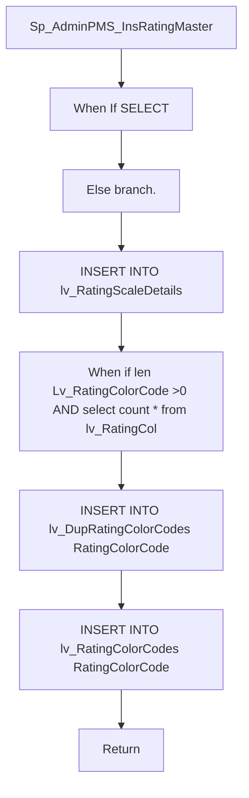

# Sp_AdminPMS_InsRatingMaster

## What it does

Stored procedure `Sp_AdminPMS_InsRatingMaster`. Writes `TPMSRatingMaster`, `TPMSRatingScaleDetails`. Calls no other procedure or function.

## Parameters

| Name | Direction | What it is for |
|---|---|---|
| `@RatingName` | in | Varchar(50) |
| `@Levels` | in | INT |
| `@EmployerId` | in | INT |
| `@CreatedBy` | in | INT |
| `@IsActive` | in | BIT |
| `@RatingScaleDetails` | in | VARCHAR(MAX) |
| `@IsAssessmentType` | in | BIT |
| `@IsOutcomeType` | in | BIT |

## Call sequence

Calls no other procedures or functions.

## Callers

No other procedure or function calls this object.

## Nested

Calls no other procedures or functions.

## Steps

1. Script is `HRMS-DATABASE/HRMS/STOREPROCEDURE/Sp_AdminPMS_InsRatingMaster.sql`.
2. When If ( SELECT
3. Else branch.
4. INSERT INTO @lv_RatingScaleDetails
5. When if(len(@Lv_RatingColorCode)>0 AND (select count(*) from @lv_RatingColorCodes where RatingColorCode=@Lv_RatingColorCode)>0)
6. INSERT INTO @lv_DupRatingColorCodes (RatingColorCode)
7. INSERT INTO @lv_RatingColorCodes (RatingColorCode)
8. When if(select count(*) from @lv_DupRatingColorCodes)>0
9. Else branch.
10. INSERT INTO TPMSRatingMaster (Ratingname, Levels, Employerid, Createdby, Createddate, Isactive, IsAssessmentType, IsOutcomeType)
11. INSERT INTO TPMSRatingScaleDetails (Ratingid, Levels, Minrating, Maxrating, Leveldescription, Remark, OutcomeExpectedValue, RatingColorCode)

## Tables

| Table | Read or write |
|---|---|
| `TPMSRatingMaster` | read and write |
| `TPMSRatingScaleDetails` | write |

## Flow

