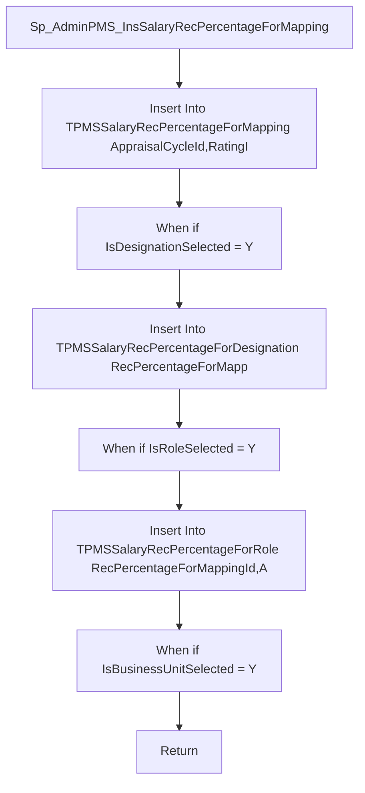

# Sp_AdminPMS_InsSalaryRecPercentageForMapping

## What it does

Stored procedure `Sp_AdminPMS_InsSalaryRecPercentageForMapping`. Writes `TPMSSalaryRecPercentageForMapping`, `TPMSSalaryRecPercentageForDesignation`, `TPMSSalaryRecPercentageForRole`, `TPMSSalaryRecPercentageForBU`, `TPMSSalaryRecPercentageForRatingScaleDetails`. Calls no other procedure or function.

## Parameters

| Name | Direction | What it is for |
|---|---|---|
| `@AppraisalCycleId` | in | int |
| `@RatingId` | in | Int |
| `@EmployerId` | in | Int |
| `@IsRoleSelected` | in | varchar(1), default NULL |
| `@IsDesignationSelected` | in | varchar(1), default NULL |
| `@IsBusinessUnitSelected` | in | varchar(1), default NULL |
| `@DesignationId` | in | Varchar(max), default NULL |
| `@RoleId` | in | Varchar(max), default NULL |
| `@BusinessUnitId` | in | Varchar(max), default NULL |
| `@RatingScaleType` | in | varchar(1), default NULL |
| `@CreatedBy` | in | Int |
| `@UDTSalaryRecPercentageForRatingScale` | in | UDT_SalaryRecPercentageForRatingScaleDetails |

## Call sequence

Calls no other procedures or functions.

## Callers

| Object | Kind | Page |
|---|---|---|
| `Sp_AdminPMS_UPDSalaryRecPercentageForMapping` | procedure | [Sp_AdminPMS_UPDSalaryRecPercentageForMapping](/docs/database/hrms/Sp_AdminPMS_UPDSalaryRecPercentageForMapping) |

## Nested

Calls no other procedures or functions.

## Steps

1. Script is `HRMS-DATABASE/HRMS/STOREPROCEDURE/Sp_AdminPMS_InsSalaryRecPercentageForMapping.sql`.
2. Insert Into TPMSSalaryRecPercentageForMapping(AppraisalCycleId,RatingId,EmployerId,IsRoleSelected,IsDesignationSelected,IsBusinessUnitSelected,RatingScaleType,CreatedBy,CreatedDate
3. When if(@IsDesignationSelected ='Y')
4. Insert Into TPMSSalaryRecPercentageForDesignation(RecPercentageForMappingId,AppraisalCycleId,RatingId,DesignationId)
5. When if(@IsRoleSelected ='Y')
6. Insert Into TPMSSalaryRecPercentageForRole(RecPercentageForMappingId,AppraisalCycleId,RatingId,RoleId)
7. When if(@IsBusinessUnitSelected ='Y')
8. Insert Into TPMSSalaryRecPercentageForBU(RecPercentageForMappingId,AppraisalCycleId,RatingId,BusinessUnitId)
9. When IF (SELECT COUNT(1) FROM @UDTSalaryRecPercentageForRatingScale) > 0
10. INSERT INTO TPMSSalaryRecPercentageForRatingScaleDetails(RecPercentageForMappingId,AppraisalCycleId,Ratingid, Levels, Minrating, Maxrating, SalaryRevisionPercent,Remarks)

## Tables

| Table | Read or write |
|---|---|
| `TPMSSalaryRecPercentageForBU` | write |
| `TPMSSalaryRecPercentageForDesignation` | write |
| `TPMSSalaryRecPercentageForMapping` | write |
| `TPMSSalaryRecPercentageForRatingScaleDetails` | write |
| `TPMSSalaryRecPercentageForRole` | write |

## Flow

