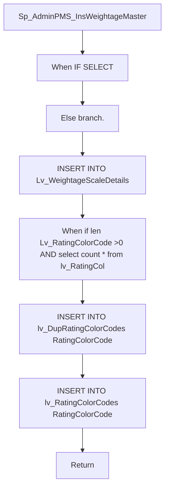

# Sp_AdminPMS_InsWeightageMaster

## What it does

Stored procedure `Sp_AdminPMS_InsWeightageMaster`. Writes `TPMSWeightageMaster`, `TPMSWeightageScaleDetails`. Calls no other procedure or function.

## Parameters

| Name | Direction | What it is for |
|---|---|---|
| `@WeightageName` | in | Varchar(50) |
| `@Levels` | in | INT |
| `@EmployerId` | in | INT |
| `@CreatedBy` | in | INT |
| `@IsActive` | in | BIT |
| `@WeightageScaleDetails` | in | VARCHAR(MAX) |

## Call sequence

Calls no other procedures or functions.

## Callers

No other procedure or function calls this object.

## Nested

Calls no other procedures or functions.

## Steps

1. Script is `HRMS-DATABASE/HRMS/STOREPROCEDURE/Sp_AdminPMS_InsWeightageMaster.sql`.
2. When IF ( SELECT
3. Else branch.
4. INSERT INTO @Lv_WeightageScaleDetails
5. When if(len(@Lv_RatingColorCode)>0 AND (select count(*) from @lv_RatingColorCodes where RatingColorCode=@Lv_RatingColorCode)>0)
6. INSERT INTO @lv_DupRatingColorCodes (RatingColorCode)
7. INSERT INTO @lv_RatingColorCodes (RatingColorCode)
8. When if(select count(*) from @lv_DupRatingColorCodes)>0
9. Else branch.
10. INSERT INTO TPMSWeightageMaster (WeightageName, Levels, EmployerId, CreatedBy, CreatedDate, IsActive)
11. INSERT INTO TPMSWeightageScaleDetails (Weightageid, Levels, MinWeightage, MaxWeightage, Leveldescription, Remark, OutcomeValue,RatingColorCode)

## Tables

| Table | Read or write |
|---|---|
| `TPMSWeightageMaster` | read and write |
| `TPMSWeightageScaleDetails` | write |

## Flow

