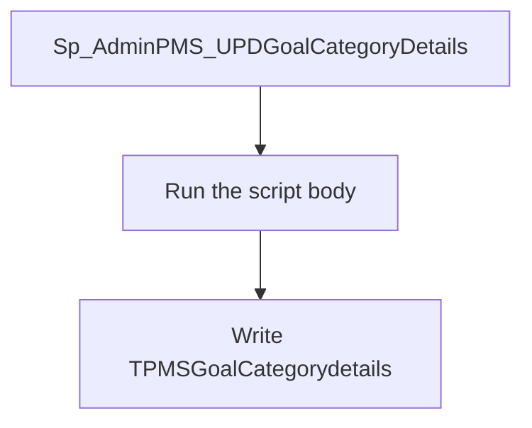

# Sp_AdminPMS_UPDGoalCategoryDetails

## What it does

Updates one goal or KRA dictionary detail row.

## Parameters

| Name | Direction | What it is for |
|---|---|---|
| `@CategoryDetailsId` | in | Category Details Id |
| `@Categoryid` | in | Categoryid |
| `@IsActive` | in | Is Active |
| `@CreatedBy` | in | Created By |
| `@DefineKRA` | in | Define KRA. Default NULL |
| `@KRADescription` | in | KRADescription. Default NULL |
| `@KPADescription` | in | KPADescription. Default NULL |
| `@AssignedTarget` | in | Assigned Target. Default NULL |
| `@MesCriteriaField1` | in | Mes Criteria Field1 |
| `@MesCriteriaField2` | in | Mes Criteria Field2 |
| `@MesCriteriaField3` | in | Mes Criteria Field3 |
| `@MesCriteriaField4` | in | Mes Criteria Field4 |
| `@MesCriteriaField5` | in | Mes Criteria Field5 |
| `@GoalName` | in | Goal Name. Default null |
| `@GoalDescription` | in | Goal Description. Default null |

## Call sequence

Calls no other procedures or functions.

## Callers

No other procedure or function calls this object.

## Nested

Calls no other procedures or functions.

## Steps

Script: `HRMS-DATABASE/HRMS/STOREPROCEDURE/Sp_AdminPMS_UPDGoalCategoryDetails.sql`.

1. Select @tempCount =count(*) From TPMSGoalCategorydetails Where Categorydetailsid =@CategoryDetailsId;
2. If (@tempCount)>0
3. update TPMSGoalCategorydetails
4. Select 1 ErrorCode
5. Select 0 ErrorCode

## Tables

| Table | Read or write |
|---|---|
| `TPMSGoalCategorydetails` | read/write |

## Flow

