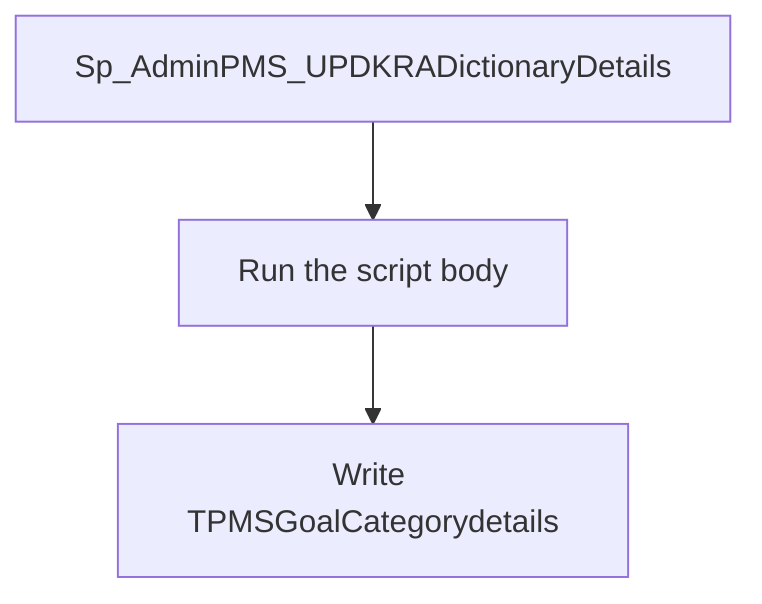

# Sp_AdminPMS_UPDKRADictionaryDetails

## What it does

Replaces or updates KRA dictionary rows for one detail id from the table-valued parameter.

## Parameters

| Name | Direction | What it is for |
|---|---|---|
| `@CategoryDetailsId` | in | Category Details Id |
| `@Categoryid` | in | Categoryid |
| `@IsActive` | in | Is Active |
| `@CreatedBy` | in | Created By |
| `@UDTTPMSKRADictionary` | in | UDTTPMSKRADictionary. Table-valued parameter |

## Call sequence

Calls no other procedures or functions.

## Callers

No other procedure or function calls this object.

## Nested

Calls no other procedures or functions.

## Steps

Script: `HRMS-DATABASE/HRMS/STOREPROCEDURE/Sp_AdminPMS_UPDKRADictionaryDetails.sql`.

1. IF(select count(1)
2. Select 0 ErrorCode,'KRA Dictionary Measure Criteria Fields Exceeds Limit' ErrorMsg
3. Return
4. Select @tempCount =count(*) From TPMSGoalCategorydetails Where Categorydetailsid =@CategoryDetailsId;
5. Select @IsMesure =IsMeasureValAvailable , @MeasurementValue=MeasurementValue from TPMSGoalCategory where Categoryid=@Categoryid
6. If ((@tempCount)>0 AND (select count(1) from @UDTTPMSKRADictionary)>0)
7. select distinct DefineKRA,KRADescription,KPADescription,AssignedTarget,
8. WHILE @@FETCH_STATUS = 0
9. if (@IsMesure =1 AND @MeasurementValue =1 AND (len(@MesCriteriaField1)=0))
10. ELSE if (@IsMesure =1 AND @MeasurementValue =2 AND (len(@MesCriteriaField1)=0 OR len(@MesCriteriaField2)=0 ))
11. ELSE if (@IsMesure =1 AND @MeasurementValue =3 AND (len(@MesCriteriaField1)=0 OR len(@MesCriteriaField2)=0 OR len(@MesCriteriaField3)=0))
12. ELSE if (@IsMesure =1 AND @MeasurementValue =4 AND (len(@MesCriteriaField1)=0 OR len(@MesCriteriaField2)=0 OR len(@MesCriteriaField3)=0 OR len(@MesCriteriaField4)=0 ))

## Tables

| Table | Read or write |
|---|---|
| `TPMSGoalCategorydetails` | read/write |
| `TPMSGoalCategory` | read |

## Flow

