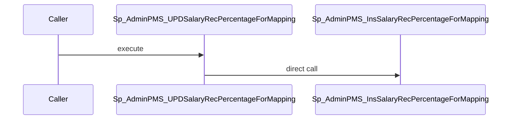
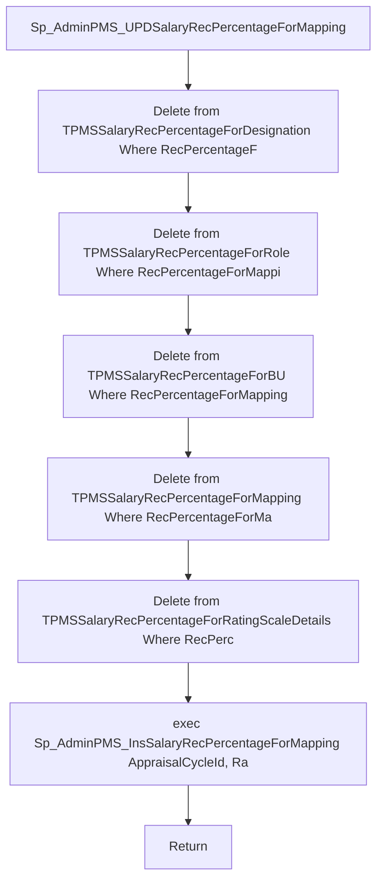

# Sp_AdminPMS_UPDSalaryRecPercentageForMapping

## What it does

Stored procedure `Sp_AdminPMS_UPDSalaryRecPercentageForMapping`. Writes `TPMSSalaryRecPercentageForDesignation`, `TPMSSalaryRecPercentageForRole`, `TPMSSalaryRecPercentageForBU`, `TPMSSalaryRecPercentageForMapping`, `TPMSSalaryRecPercentageForRatingScaleDetails`. Calls `Sp_AdminPMS_InsSalaryRecPercentageForMapping`.

## Parameters

| Name | Direction | What it is for |
|---|---|---|
| `@AppraisalCycleId` | in | int |
| `@RatingId` | in | Int |
| `@EmployerId` | in | Int |
| `@IsRoleSelected` | in | varchar(1), default NULL |
| `@IsDesignationSelected` | in | varchar(1), default NULL |
| `@IsBusinessUnitSelected` | in | varchar(1), default NULL |
| `@DesignationId` | in | Varchar(Max), default NULL |
| `@RoleId` | in | Varchar(Max), default NULL |
| `@BusinessUnitId` | in | Varchar(Max), default NULL |
| `@RatingScaleType` | in | varchar(1), default NULL |
| `@ModifiedBy` | in | Int |
| `@RecPercentageForMappingid` | in | int |
| `@UDTSalaryRecPercentageForRatingScale` | in | UDT_SalaryRecPercentageForRatingScaleDetails |

## Call sequence

## Callers

No other procedure or function calls this object.

## Nested

| Object | Kind | When | Page |
|---|---|---|---|
| `Sp_AdminPMS_InsSalaryRecPercentageForMapping` | procedure | direct call | [Sp_AdminPMS_InsSalaryRecPercentageForMapping](/docs/database/hrms/Sp_AdminPMS_InsSalaryRecPercentageForMapping) |

## Steps

1. Script is `HRMS-DATABASE/HRMS/STOREPROCEDURE/Sp_AdminPMS_UPDSalaryRecPercentageForMapping.sql`.
2. Delete from TPMSSalaryRecPercentageForDesignation Where RecPercentageForMappingId = @RecPercentageForMappingid and RatingId=@RatingId and AppraisalCycleId=@AppraisalCycleId;
3. Delete from TPMSSalaryRecPercentageForRole Where RecPercentageForMappingId = @RecPercentageForMappingid and RatingId=@RatingId and AppraisalCycleId=@AppraisalCycleId;
4. Delete from TPMSSalaryRecPercentageForBU Where RecPercentageForMappingId = @RecPercentageForMappingid and RatingId=@RatingId and AppraisalCycleId=@AppraisalCycleId;
5. Delete from TPMSSalaryRecPercentageForMapping Where RecPercentageForMappingId = @RecPercentageForMappingid and RatingId=@RatingId and EmployerId=@EmployerId and AppraisalCycleId=@A
6. Delete from TPMSSalaryRecPercentageForRatingScaleDetails Where RecPercentageForMappingId = @RecPercentageForMappingid and RatingId=@RatingId and AppraisalCycleId=@AppraisalCycleId;
7. exec Sp_AdminPMS_InsSalaryRecPercentageForMapping @AppraisalCycleId,@RatingId,@EmployerId,@IsRoleSelected,@IsDesignationSelected,@IsBusinessUnitSelected,

## Tables

| Table | Read or write |
|---|---|
| `TPMSSalaryRecPercentageForBU` | read and write |
| `TPMSSalaryRecPercentageForDesignation` | read and write |
| `TPMSSalaryRecPercentageForMapping` | read and write |
| `TPMSSalaryRecPercentageForRatingScaleDetails` | read and write |
| `TPMSSalaryRecPercentageForRole` | read and write |

## Flow

