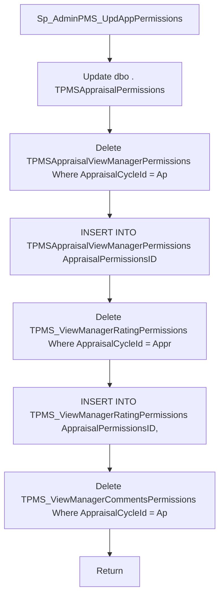

# Sp_AdminPMS_UpdAppPermissions

## What it does

Stored procedure `Sp_AdminPMS_UpdAppPermissions`. Writes `TPMSAppraisalViewManagerPermissions`, `TPMS_ViewManagerRatingPermissions`, `TPMS_ViewManagerCommentsPermissions`, `TPMS_ViewEmpManagerRatingPermissions`, `TPMSAppraisalPermissions`. Calls no other procedure or function.

## Parameters

| Name | Direction | What it is for |
|---|---|---|
| `@AppraisalPermissionsID` | in | Int |
| `@AppraisalCycleId` | in | Int |
| `@EmployeeIDs` | in | Varchar(max) |
| `@EmployeeTypes` | in | Varchar(max) |
| `@EmployeeDesignation` | in | Varchar(max) |
| `@OrganizationUnits` | in | Varchar(max) |
| `@ViewComment` | in | Bit |
| `@IsDeleted` | in | Bit |
| `@ModifiedBy` | in | Int |
| `@EmpCommentsMandatory` | in | BIT |
| `@MngrCommentsMandatory` | in | BIT |
| `@UDTAppraisalViewManagerPermissions` | in | UDTAppraisalViewManagerPermissions |
| `@UDTAppraisalManagerRatingPermissions` | in | UDTAppraisalViewManagerPermissions |
| `@UDTAppraisalManagerCommentsPermissions` | in | UDTAppraisalViewManagerPermissions |
| `@UDTAppViewEmpManagerRatingPermissions` | in | UDTAppraisalViewManagerPermissions |
| `@ViewManagerRatingsRequired` | in | bit, default 0 |
| `@ViewEmpManagerRatingsRequired` | in | BIT, default 0 |
| `@ViewEmpManagerCommentsRequired` | in | BIT, default 0 |
| `@IsEnableFinalWeightageToEmp` | in | BIT, default 0 |

## Call sequence

Calls no other procedures or functions.

## Callers

No other procedure or function calls this object.

## Nested

Calls no other procedures or functions.

## Steps

1. Script is `HRMS-DATABASE/HRMS/STOREPROCEDURE/Sp_AdminPMS_UpdAppPermissions.sql`.
2. Update [dbo].[TPMSAppraisalPermissions]
3. Delete TPMSAppraisalViewManagerPermissions Where AppraisalCycleId = @AppraisalCycleId;
4. INSERT INTO TPMSAppraisalViewManagerPermissions (AppraisalPermissionsID, AppraisalCycleId,ReviewLevelId, ReviewLevel,IsDeleted)
5. Delete TPMS_ViewManagerRatingPermissions Where AppraisalCycleId = @AppraisalCycleId;
6. INSERT INTO TPMS_ViewManagerRatingPermissions (AppraisalPermissionsID, AppraisalCycleId,ReviewLevelId, ReviewLevel,IsDeleted)
7. Delete TPMS_ViewManagerCommentsPermissions Where AppraisalCycleId = @AppraisalCycleId;
8. INSERT INTO TPMS_ViewManagerCommentsPermissions (AppraisalPermissionsID, AppraisalCycleId,IsDeleted,ReviewLevelId, ReviewLevel)
9. Delete TPMS_ViewEmpManagerRatingPermissions Where AppraisalCycleId = @AppraisalCycleId;
10. INSERT INTO TPMS_ViewEmpManagerRatingPermissions (AppraisalPermissionsID, AppraisalCycleId,IsDeleted,ReviewLevelId, ReviewLevel)

## Tables

| Table | Read or write |
|---|---|
| `TPMSAppraisalPermissions` | write |
| `TPMSAppraisalViewManagerPermissions` | write |
| `TPMS_ViewEmpManagerRatingPermissions` | write |
| `TPMS_ViewManagerCommentsPermissions` | write |
| `TPMS_ViewManagerRatingPermissions` | write |

## Flow

