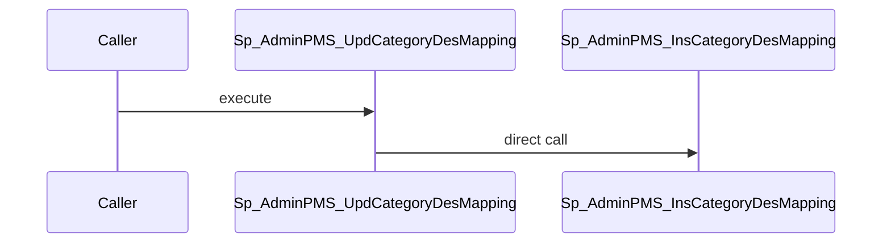
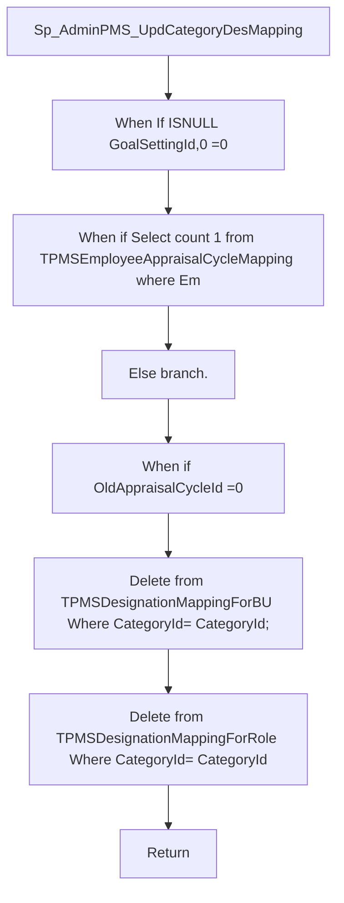

# Sp_AdminPMS_UpdCategoryDesMapping

## What it does

Stored procedure `Sp_AdminPMS_UpdCategoryDesMapping`. Writes `TPMSDesignationMappingForBU`, `TPMSDesignationMappingForRole`, `TPMSDesignationMappingForDesignation`, `TPMSCategoryDesignationMapping`. Reads `TPMSEmployeeAppraisalCycleMapping`, `TPMSAppraisalCycles`. Calls `Sp_AdminPMS_InsCategoryDesMapping`.

## Parameters

| Name | Direction | What it is for |
|---|---|---|
| `@CategoryId` | in | int |
| `@DesignationId` | in | varchar(4000) |
| `@EmployerId` | in | int |
| `@ModifiedBy` | in | int |
| `@RoleId` | in | Varchar(4000), default NULL |
| `@BusinessUnitId` | in | Varchar(4000), default NULL |
| `@IsRoleSelected` | in | varchar(1), default NULL |
| `@IsDesignationSelected` | in | varchar(1), default NULL |
| `@IsBusinessUnitSelected` | in | varchar(1), default NULL |
| `@AppraisalCycleId` | in | int, default NULL |
| `@OldAppraisalCycleId` | in | int, default NULL |
| `@GoalSettingId` | in | int, default null |
| `@FormType` | in | varchar(1), default NULL |
| `@EmployeeId` | in | INT, default 0 |

## Call sequence

## Callers

No other procedure or function calls this object.

## Nested

| Object | Kind | When | Page |
|---|---|---|---|
| `Sp_AdminPMS_InsCategoryDesMapping` | procedure | direct call | [Sp_AdminPMS_InsCategoryDesMapping](/docs/database/hrms/Sp_AdminPMS_InsCategoryDesMapping) |

## Steps

1. Script is `HRMS-DATABASE/HRMS/STOREPROCEDURE/Sp_AdminPMS_UpdCategoryDesMapping.sql`.
2. When If(ISNULL(@GoalSettingId,0)=0)
3. When if (Select count(1) from TPMSEmployeeAppraisalCycleMapping where Employerid=@EmployerId and Categoryid=@CategoryId and AppraisalCycleId=@AppraisalCycleId
4. Else branch.
5. When if(@OldAppraisalCycleId =0)
6. Delete from TPMSDesignationMappingForBU Where CategoryId=@CategoryId;
7. Delete from TPMSDesignationMappingForRole Where CategoryId=@CategoryId;
8. Delete from TPMSDesignationMappingForDesignation Where CategoryId=@CategoryId;
9. Delete from TPMSCategoryDesignationMapping Where CategoryId=@CategoryId and EmployerId=@EmployerId;
10. Else branch.
11. Delete from TPMSDesignationMappingForBU Where CategoryId=@CategoryId and AppraisalCycleId=@AppraisalCycleId;
12. Delete from TPMSDesignationMappingForRole Where CategoryId=@CategoryId and AppraisalCycleId=@AppraisalCycleId;
13. Delete from TPMSDesignationMappingForDesignation Where CategoryId=@CategoryId and AppraisalCycleId=@AppraisalCycleId;
14. Delete from TPMSCategoryDesignationMapping Where CategoryId=@CategoryId and EmployerId=@EmployerId and AppraisalCycleId=@AppraisalCycleId;
15. exec Sp_AdminPMS_InsCategoryDesMapping @CategoryId,@DesignationId,
16. Else branch.
17. Delete from TPMSDesignationMappingForBU Where CategoryId=@CategoryId and GoalSettingId=@GoalSettingId;
18. Delete from TPMSDesignationMappingForRole Where CategoryId=@CategoryId and GoalSettingId=@GoalSettingId;
19. Delete from TPMSDesignationMappingForDesignation Where CategoryId=@CategoryId and GoalSettingId=@GoalSettingId;
20. Delete from TPMSCategoryDesignationMapping Where CategoryId=@CategoryId and EmployerId=@EmployerId and GoalSettingId=@GoalSettingId;
21. exec Sp_AdminPMS_InsCategoryDesMapping @CategoryId,@DesignationId,

## Tables

| Table | Read or write |
|---|---|
| `TPMSAppraisalCycles` | read |
| `TPMSCategoryDesignationMapping` | read and write |
| `TPMSDesignationMappingForBU` | read and write |
| `TPMSDesignationMappingForDesignation` | read and write |
| `TPMSDesignationMappingForRole` | read and write |
| `TPMSEmployeeAppraisalCycleMapping` | read |

## Flow

