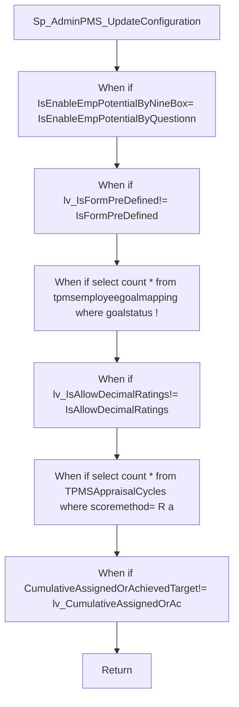

# Sp_AdminPMS_UpdateConfiguration

## What it does

Stored procedure `Sp_AdminPMS_UpdateConfiguration`. Writes `TPMSAssessmentViewManagerPermissions`, `TPMS_GoalDefinationPermissions`, `TPMS_GoalAdditionalCompPermissions`, `TEmployeeGoalSettingReviewLevelMaster`, `TPMSEmployerConfiguration`. Reads `tpmsemployeegoalmapping`, `TPMSAppraisalCycles`, `TPMSEmployeeSelfAppraisal`, `TWorkflowManagement`, `TWorkFlowBusinessUnits`, `TWorkFlowLocations`, `temployerdetails`. Calls no other procedure or function.

## Parameters

| Name | Direction | What it is for |
|---|---|---|
| `@IsMultipleAppraisal` | in | bit |
| `@IsReviewFrequencyEnabled` | in | bit |
| `@IsPMSButtonSaveChanges` | in | bit |
| `@EmployerId` | in | int |
| `@IsPMSReviewerEnabled` | in | bit |
| `@IsAssessmentTenureEnabled` | in | bit |
| `@IsSelfassessmentIsRequired` | in | bit |
| `@CalculateFinalRatingAsAverage` | in | bit |
| `@IsEmployeeRoleMappingTypeEnabled` | in | bit |
| `@IsDesignationMappingTypeEnabled` | in | bit |
| `@IsBusinessUnitMappingTypeEnabled` | in | bit |
| `@IsAppraisalMappingTypeEnabled` | in | bit |
| `@IsAutomaticPMSReviewFrequency` | in | bit, default 0 |
| `@IsAutomaticGoalReviewFrequency` | in | bit, default 0 |
| `@IsAutomaticEditEmployeeSetGoals` | in | bit, default 0 |
| `@IsNormalizedRatingsFinalRatings` | in | bit, default 0 |
| `@AdditionalContentFormDesign` | in | bit, default 0 |
| `@IsAllowDecimalRatings` | in | bit, default 0 |
| `@IsAllowedForNotifcationGoalFreeze` | in | bit, default 1 |
| `@PerformanceDueDays` | in | int, default 0 |
| `@IsAllowAutoSaveChangesForPMS` | in | bit, default 0 |
| `@IsPMSViewHRComments` | in | bit, default 0 |
| `@IsAllowEmpWtgRating` | in | bit, default 0 |
| `@IsInclusionOfNewJoinees` | in | bit, default 0 |
| `@ISDateOfJoining` | in | bit, default 0 |
| `@ISDateOfConfirmation` | in | bit, default 0 |
| `@IsEmployeeOverallComments` | in | bit, default -0 |
| `@IsNormalized` | in | bit, default 0 |
| `@UDTAppraisalViewManagerPermissions` | in | UDTAppraisalViewManagerPermissions |
| `@IsFormPreDefined` | in | bit, default 1 |
| `@IsAssessmentForMultipleGoalForms` | in | bit, default 0 |
| `@IsPersonalDataToShow` | in | bit, default 0 |
| `@IsEnableGoalDefForGoalForm` | in | bit, default 0 |
| `@IsEnableAddCompForGoalForm` | in | bit, default 0 |
| `@IsEmpOverallCommentsForAssessment` | in | bit, default 0 |
| `@IsAverageScoreToShowOnAssessment` | in | bit, default 1 |
| `@IsCompetencyToShowOnEachAssessment` | in | bit, default 1 |
| `@IsEnableExportAssessmentForm` | in | bit, default 0 |
| `@IsEnableRemoveRatingLevelFromDefination` | in | bit, default 0 |
| `@IsEnableGoalFormMappingType` | in | bit, default 0 |
| `@IsEnableNineBoxGrid` | in | bit, default 0 |
| `@IsEnableEmpPotentialByNineBox` | in | bit, default 0 |
| `@IsEnableEmpPotentialByQuestionnaire` | in | bit, default 0 |
| `@IsEnableEmpToViewNineBoxGrid` | in | bit, default 0 |
| `@IsEnableKRAAchievedTarget` | in | bit, default 0 |
| `@EnableAutoCalForMeasure` | in | bit, default 0 |
| `@UDTGoalDefinationPermissions` | in | UDTAppraisalViewManagerPermissions |
| `@UDTGoalAdditionalCompPermissions` | in | UDTAppraisalViewManagerPermissions |
| `@IsEnabledCopyGoalForm` | in | bit, default 1 |
| `@IsShowPMSTeamAssessmentForEmployeeRole` | in | bit, default 1 |
| `@IsSendEmailToEmployeesAfterAssessment` | in | bit, default 0 |
| `@MeasureSyncWithRatingLevel` | in | bit, default 0 |
| `@CumulativeAssignedOrAchievedTarget` | in | bit, default 0 |
| `@IsEnableRemoveRatingDefinationFromLevel` | in | bit, default 0 |
| `@IsDisableKRAEmptyFields` | in | bit, default 0 |
| `@IsHideAssessmentTabs` | in | bit, default 0 |
| `@IsEnableAssessmentFormMappingType` | in | bit, default 0 |
| `@SalaryRevisionBy` | in | varchar(1), default 'P' |
| `@IsGoalFormWithWorkFlow` | in | bit, default 0 |
| `@IsEnableWhatsAppNotifications` | in | bit, default 0 |
| `@IsEnableActiveResignedEmployeesForPMS` | in | bit, default 0 |
| `@IsEnablePMSAIIntegration` | in | bit, default 0 |
| `@PMSOpenAIApiKey` | in | varchar(2000) |
| `@PMSOpenAIModel` | in | varchar(2000) |
| `@IsDeclineAckForLastApprover` | in | bit, default 0 |
| `@IsEnableGoalAdditionalComponents` | in | bit |
| `@IsEnableApprovalLevelAutoPopulation` | in | bit, default 0 |
| `@IsEnablePDFDownloadAssessmentRequest` | in | bit, default 0 |
| `@IsPMSFinalScoreDisplayFormat` | in | varchar(1), default 'B' |
| `@PMSOpenAIURL` | in | varchar(2000), default NULL |
| `@IsAutoCloseAppraisalOnResignation` | in | bit, default 0 |
| `@AutoCloseTriggerPoint` | in | varchar(1), default 'A' |
| `@IsReopenFormOnResignationPullback` | in | bit, default 0 |
| `@ReopenFormTriggerPoint` | in | varchar(1), default 'A' |
| `@ReopenFormBehavior` | in | varchar(1), default 'S' |
| `@ReopenMode` | in | varchar(1), default 'R' |
| `@EmpAcknowledgementComment` | in | VARCHAR(2000), default NULL |
| `@MinServiceRequiredForAssessment` | in | int, default 0 |

## Call sequence

Calls no other procedures or functions.

## Callers

No other procedure or function calls this object.

## Nested

Calls no other procedures or functions.

## Steps

1. Script is `HRMS-DATABASE/HRMS/STOREPROCEDURE/Sp_AdminPMS_UpdateConfiguration.sql`.
2. When if((@IsEnableEmpPotentialByNineBox=@IsEnableEmpPotentialByQuestionnaire) AND @IsEnableNineBoxGrid =1)
3. When if(@lv_IsFormPreDefined!=@IsFormPreDefined)
4. When if((select count(*) from tpmsemployeegoalmapping where goalstatus !='Force Closed' and FormApproved=0 and employerid=@EmployerId)>0)
5. When if(@lv_IsAllowDecimalRatings!=@IsAllowDecimalRatings)
6. When if((select count(*) from TPMSAppraisalCycles where scoremethod='R' and cyclestatus ='Initiated' and EmployerID =@EmployerId)>0)
7. When if(@CumulativeAssignedOrAchievedTarget!=@lv_CumulativeAssignedOrAchievedTarget)
8. When if((select count(*) from TPMSAppraisalCycles where scoremethod='M' and cyclestatus ='Initiated' and EmployerID =@EmployerId)>0)
9. When if(@lv_IsSelfassessmentIsRequired!=@IsSelfassessmentIsRequired)
10. When if(@lv_IsSelfassessmentIsRequired =1 AND (select count(*) from tpmsemployeegoalmapping where goalstatus !='Force Closed' and FormApproved=0 and employerid=@Empl
11. Else branch.
12. When if(@lv_CalculateFinalRatingAsAverage!=@CalculateFinalRatingAsAverage)
13. When if((SELECT count(*) FROM TPMSEmployeeSelfAppraisal sa, TPMSAppraisalCycles ac where sa.AppraisalCycleid=ac.AppraisalCycleid and Formstatus NOT in ('Approved','F
14. UPDATE TPMSEmployerConfiguration
15. Delete TPMSAssessmentViewManagerPermissions Where Employerid=@EmployerId
16. INSERT INTO TPMSAssessmentViewManagerPermissions (EmployerID, ReviewLevelId,ReviewLevel)
17. INSERT INTO @TableName (
18. INSERT INTO @TableReviewLevel(ReviewLevelId,EmployeeRoleName,Approvallevel)
19. Delete TPMS_GoalDefinationPermissions Where Employerid=@EmployerId
20. INSERT INTO TPMS_GoalDefinationPermissions (EmployerID, ReviewLevelId,ReviewLevel,RowNo )
21. Delete TPMS_GoalAdditionalCompPermissions Where Employerid=@EmployerId
22. INSERT INTO TPMS_GoalAdditionalCompPermissions (EmployerID, ReviewLevelId,ReviewLevel,RowNo)
23. When if((select Count(1) from TEmployeeGoalSettingReviewLevelMaster where employerid=@EmployerId) =0)
24. Insert into TEmployeeGoalSettingReviewLevelMaster(EmployeeRoleName, EmployeeRoleDesc, IsActive, CreatedBy, CreatedDate, UpdatedBy, Updatedate, Employerid ,FormType)

## Tables

| Table | Read or write |
|---|---|
| `TEmployeeGoalSettingReviewLevelMaster` | read and write |
| `TPMSAppraisalCycles` | read |
| `TPMSAssessmentViewManagerPermissions` | write |
| `TPMSEmployeeSelfAppraisal` | read |
| `TPMSEmployerConfiguration` | read and write |
| `TPMS_GoalAdditionalCompPermissions` | write |
| `TPMS_GoalDefinationPermissions` | write |
| `TWorkFlowBusinessUnits` | read |
| `TWorkFlowLocations` | read |
| `TWorkflowManagement` | read |
| `temployerdetails` | read |
| `tpmsemployeegoalmapping` | read |

## Flow

