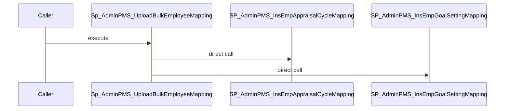
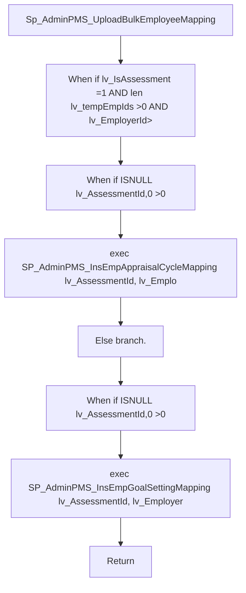

# Sp_AdminPMS_UploadBulkEmployeeMapping

## What it does

Stored procedure `Sp_AdminPMS_UploadBulkEmployeeMapping`. Reads `TEmployeeInfo`, `TPMSAPPRAISALCYCLES`, `TPMSEMPLOYEEGOALSETTING`. Calls `SP_AdminPMS_InsEmpAppraisalCycleMapping`, `SP_AdminPMS_InsEmpGoalSettingMapping`.

## Parameters

| Name | Direction | What it is for |
|---|---|---|
| `@uploadBulkEmployeeMapping` | in | [dbo] |

## Call sequence

## Callers

No other procedure or function calls this object.

## Nested

| Object | Kind | When | Page |
|---|---|---|---|
| `SP_AdminPMS_InsEmpAppraisalCycleMapping` | procedure | direct call | [SP_AdminPMS_InsEmpAppraisalCycleMapping](/docs/database/hrms/SP_AdminPMS_InsEmpAppraisalCycleMapping) |
| `SP_AdminPMS_InsEmpGoalSettingMapping` | procedure | direct call | [SP_AdminPMS_InsEmpGoalSettingMapping](/docs/database/hrms/SP_AdminPMS_InsEmpGoalSettingMapping) |

## Steps

1. Script is `HRMS-DATABASE/HRMS/STOREPROCEDURE/Sp_AdminPMS_UploadBulkEmployeeMapping.sql`.
2. When if(@lv_IsAssessment =1 AND len(@lv_tempEmpIds)>0 AND @lv_EmployerId>0)
3. When if(ISNULL(@lv_AssessmentId,0)>0)
4. exec SP_AdminPMS_InsEmpAppraisalCycleMapping @lv_AssessmentId,@lv_EmployerId,@lv_tempEmpIds,-1,'INSERT'
5. Else branch.
6. When if(ISNULL(@lv_AssessmentId,0)>0)
7. exec SP_AdminPMS_InsEmpGoalSettingMapping @lv_AssessmentId,@lv_EmployerId,@lv_tempEmpIds,-1
8. Else branch.

## Tables

| Table | Read or write |
|---|---|
| `TEmployeeInfo` | read |
| `TPMSAPPRAISALCYCLES` | read |
| `TPMSEMPLOYEEGOALSETTING` | read |

## Flow

