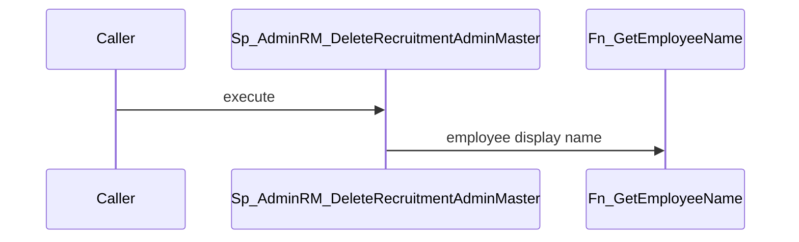
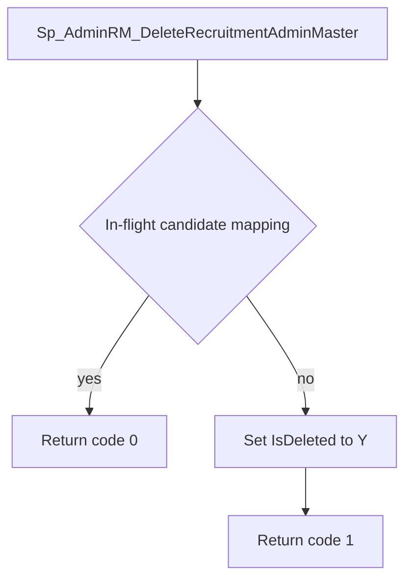

# Sp_AdminRM_DeleteRecruitmentAdminMaster

## What it does

Soft-deletes one recruitment admin by setting `IsDeleted` to `Y` and `IsActive` to 0. The delete is refused when that employee still owns a candidate mapping in a hiring or offer status. The procedure returns the employee name and `Code` 1 or 0.

## Parameters

| Name | Direction | What it is for |
|---|---|---|
| `@RecruitmentAdminId` | in | Row to mark deleted |
| `@EmployeeId` | in | Employee checked against candidate mappings |
| `@Updatedby` | in | Actor |

## Call sequence

## Callers

No other procedure or function calls this object.

`recruitmentDAL.DeleteRecruitmentAdminMasterData` calls it from Recruitment Management.

## Nested

| Object | Kind | When | Page |
|---|---|---|---|
| `Fn_GetEmployeeName` | function | on both return paths | [Fn_GetEmployeeName](/docs/database/hrms/Fn_GetEmployeeName) |

## Steps

1. Count `TRRSCandidateMapping` rows for `@EmployeeId` joined to the same hiring and offer status descriptions used by the insert procedure (`Sp_AdminRM_DeleteRecruitmentAdminMaster.sql`).
2. When the count is greater than 0, return `Code` 0.
3. Otherwise update `TRecruitmentAdminMaster` for `@RecruitmentAdminId` and return `Code` 1.

## Tables

| Table | Read or write |
|---|---|
| `TRRSCandidateMapping` | read |
| `tref_candidate_status` | read |
| `TRecruitmentAdminMaster` | write |

## Flow

