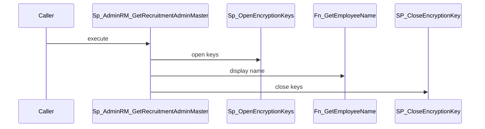
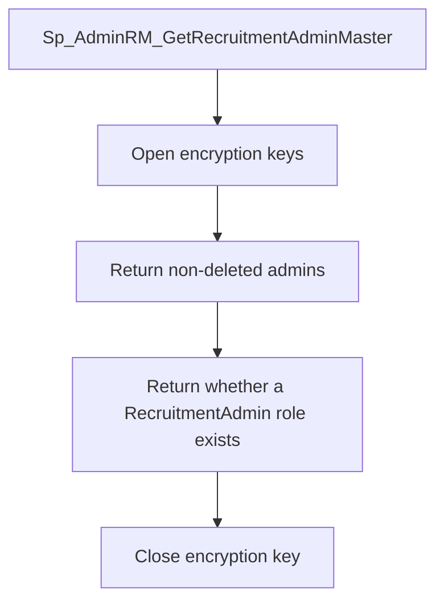

# Sp_AdminRM_GetRecruitmentAdminMaster

## What it does

Returns two result sets. The first is the employer's recruitment admins that are not deleted. The second says whether the employer still has an active employee whose user role type is `RecruitmentAdmin`.

## Parameters

| Name | Direction | What it is for |
|---|---|---|
| `@employerId` | in | Organisation |
| `@IsActive` | in | Optional active filter. Null keeps every non-deleted row |
| `@EmployeeId` | in | Optional employee filter |

## Call sequence

## Callers

No other procedure or function calls this object.

`recruitmentDAL.GetRecruitmentAdminList` calls it from Recruitment Management.

## Nested

| Object | Kind | When | Page |
|---|---|---|---|
| `Sp_OpenEncryptionKeys` | procedure | before the selects | [Sp_OpenEncryptionKeys](/docs/database/hrms/Sp_OpenEncryptionKeys) |
| `Fn_GetEmployeeName` | function | for each admin name | [Fn_GetEmployeeName](/docs/database/hrms/Fn_GetEmployeeName) |
| `SP_CloseEncryptionKey` | procedure | after both result sets | [SP_CloseEncryptionKey](/docs/database/hrms/SP_CloseEncryptionKey) |

## Steps

1. `EXEC Sp_OpenEncryptionKeys` (`Sp_AdminRM_GetRecruitmentAdminMaster.sql`).
2. Select non-deleted `TRecruitmentAdminMaster` rows for the employer. Apply `@IsActive` and `@EmployeeId` only when those arguments are not null. The display name is the employee name plus the employment number.
3. Count active employees on this employer whose `TRoles.RoleType` is `RecruitmentAdmin`. Return 1 when the count is at least 1, otherwise 0, as `IsAdminAvailable`.
4. `EXEC SP_CloseEncryptionKey`.

## Tables

| Table | Read or write |
|---|---|
| `TRecruitmentAdminMaster` | read |
| `tEmployee` | read |
| `TEmployeeInfo` | read |
| `TEmployee` | read |
| `TUserEmployee` | read |
| `TUsers` | read |
| `TRoles` | read |

## Flow

