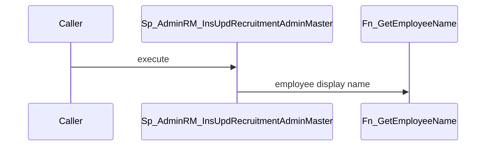
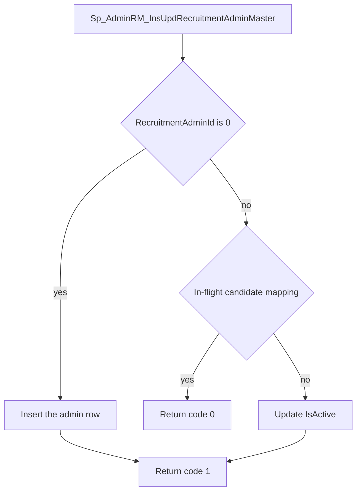

# Sp_AdminRM_InsUpdRecruitmentAdminMaster

## What it does

Inserts a recruitment admin, or updates the active flag on an existing row. An update is refused when that employee still owns a candidate mapping in a hiring or offer status. Both paths return the employee name and a `Code` of 1 for a write, or 0 when the update is refused.

## Parameters

| Name | Direction | What it is for |
|---|---|---|
| `@EmployeeId` | in | Employee being named as a recruitment admin |
| `@EmployerId` | in | Organisation. Used on insert |
| `@CreatedBy` | in | Actor. Stored as `UpdatedBy` on update |
| `@IsActive` | in | Active flag |
| `@RecruitmentAdminId` | in | 0 inserts. Any other value takes the update path |

## Call sequence

## Callers

No other procedure or function calls this object.

`recruitmentDAL.InsertUpdateRecruitmentAdminMaster` calls it from Recruitment Management.

## Nested

| Object | Kind | When | Page |
|---|---|---|---|
| `Fn_GetEmployeeName` | function | on every return path | [Fn_GetEmployeeName](/docs/database/hrms/Fn_GetEmployeeName) |

## Steps

1. When `@RecruitmentAdminId` is null or 0, insert `TRecruitmentAdminMaster` with `IsDeleted` `N` and return `Code` 1 (`Sp_AdminRM_InsUpdRecruitmentAdminMaster.sql`).
2. Otherwise count `TRRSCandidateMapping` rows for this employee whose `tref_candidate_status.Description` is one of the hiring and offer statuses listed in the script.
3. When that count is greater than 0, return `Code` 0 and do not update.
4. Otherwise set `IsActive`, `UpdatedBy`, and `Updatedate` on the recruitment-admin id and return `Code` 1.

## Tables

| Table | Read or write |
|---|---|
| `TRecruitmentAdminMaster` | write |
| `TRRSCandidateMapping` | read |
| `tref_candidate_status` | read |

## Flow

