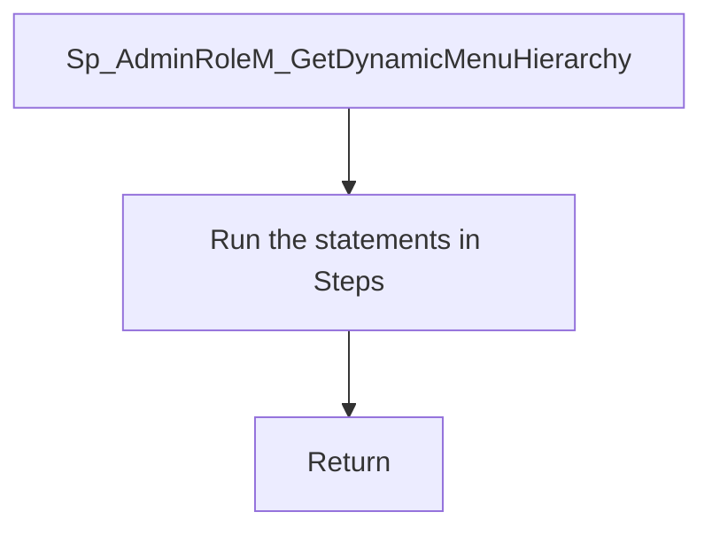

# Sp_AdminRoleM_GetDynamicMenuHierarchy

## What it does

Returns DynamicMenuXML and Transid for an employer. When that employer has no row, it uses the parent employer. When the parent also has none, it uses employer 0.

## Parameters

| Name | Direction | What it is for |
|---|---|---|
| `@Employerid` | in | Employer whose menu XML is loaded |

## Call sequence

Calls no other procedures or functions.

## Callers

No other procedure or function calls this object.

## Nested

Calls no other procedures or functions.

## Steps

1. Read parentemployerid from Temployerdetails.
2. When TDynamicMenuHierarchy has rows for @Employerid, return those.
3. Otherwise return the parent employer's rows, or employer 0 when the parent has none.

## Tables

| Table | Read or write |
|---|---|
| `Temployerdetails` | read |
| `TDynamicMenuHierarchy` | read |

## Flow

