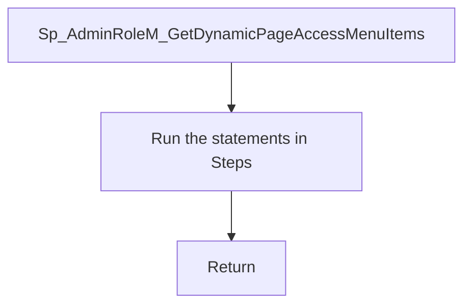

# Sp_AdminRoleM_GetDynamicPageAccessMenuItems

## What it does

Returns the menu page ids already granted to a role, with the menu name from TMenuDetails for the same employer.

## Parameters

| Name | Direction | What it is for |
|---|---|---|
| `@Employerid` | in | Employer on the mapping and on the menu name |
| `@RoleId` | in | Role whose pages are listed |

## Call sequence

Calls no other procedures or functions.

## Callers

No other procedure or function calls this object.

## Nested

Calls no other procedures or functions.

## Steps

1. Read PageId from tRolePagesMapping for the role and employer.
2. Look up MenuName from TMenuDetails where MenuID equals PageId and Employerid matches.

## Tables

| Table | Read or write |
|---|---|
| `tRolePagesMapping` | read |
| `TMenuDetails` | read |

## Flow

