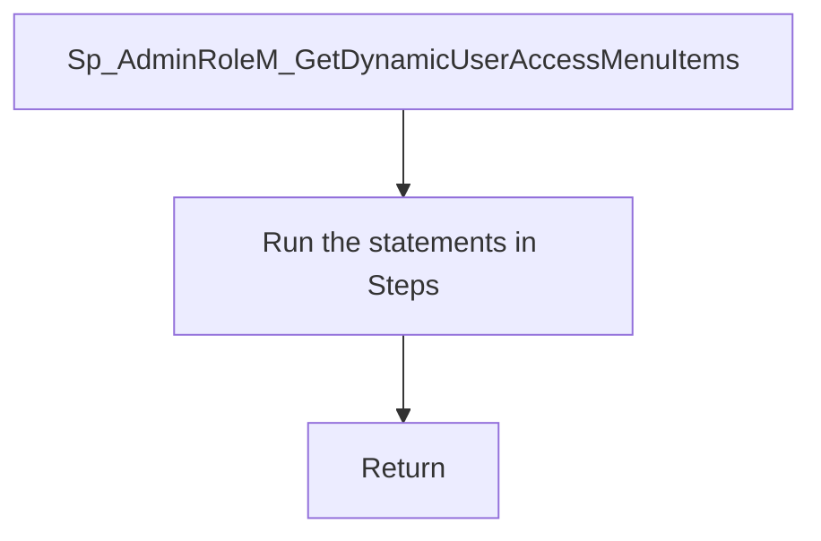

# Sp_AdminRoleM_GetDynamicUserAccessMenuItems

## What it does

Returns the extra page ids granted to one user and the menu name from TMenuDetails.

## Parameters

| Name | Direction | What it is for |
|---|---|---|
| `@userid` | in | User id |
| `@Employerid` | in | Employer on the mapping and the menu name |

## Call sequence

Calls no other procedures or functions.

## Callers

No other procedure or function calls this object.

## Nested

Calls no other procedures or functions.

## Steps

1. Read PageId from TUSerPagesMapping and look up MenuName from TMenuDetails for the same employer.

## Tables

| Table | Read or write |
|---|---|
| `TUSerPagesMapping` | read |
| `TMenuDetails` | read |

## Flow

