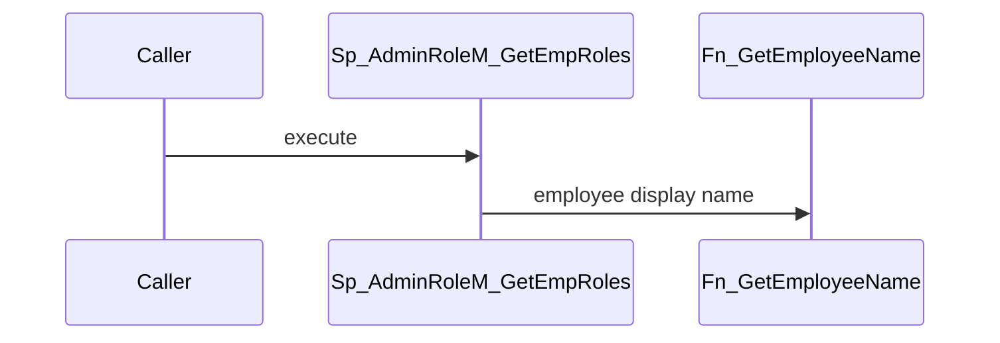
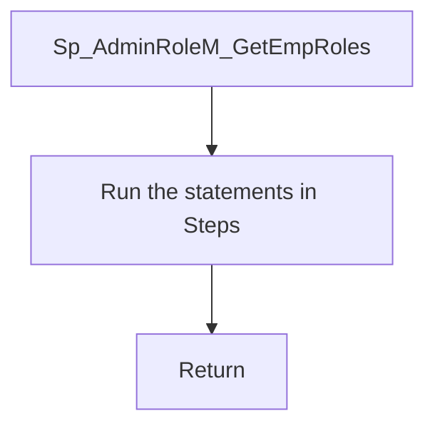

# Sp_AdminRoleM_GetEmpRoles

## What it does

Lists active employees for an employer with the role, global-access flag, report scope, location ids, business unit ids, and organization names currently stored for each user.

## Parameters

| Name | Direction | What it is for |
|---|---|---|
| `@EmployerID` | in | Employer whose employees are listed |

## Call sequence

## Callers

No other procedure or function calls this object.

## Nested

| Object | Kind | When | Page |
|---|---|---|
| `Fn_GetEmployeeName` | function | employee display name | [Fn_GetEmployeeName](/docs/database/hrms/Fn_GetEmployeeName) |

## Steps

1. Load active roles for the employer, including employer-0 defaults, into #EmpRoles.
2. Join active employees to TUserEmployee, TUsers, that role list, optional TUSerPagesMapping, and the role named by TUsers.ReportingType.
3. Map reporting role names Manager, Administrator, and Employee to Team, All, and Self.
4. Aggregate employer names from the user's employer id list and return one row per user ordered by employment number.

## Tables

| Table | Read or write |
|---|---|
| `TRoles` | read |
| `TEmployee` | read |
| `TEmployeeInfo` | read |
| `TUserEmployee` | read |
| `TUsers` | read |
| `TUSerPagesMapping` | read |
| `TEmployerDetails` | read |

## Flow

